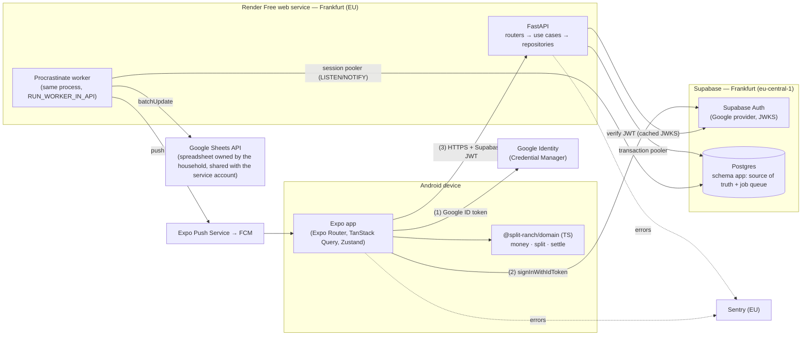
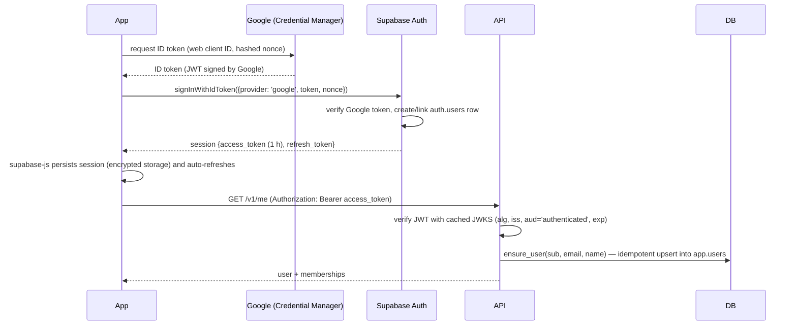
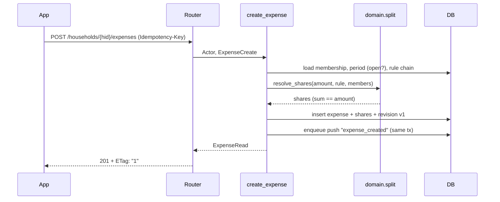

# 01 — Architecture

## Overview



One backend codebase contains the HTTP API and the worker. Both share the same Python package, the same use cases and the same database. They can run as two processes (`procrastinate … worker`, used locally by `pnpm backend:dev`) or as one: in production the worker runs as an asyncio task inside the API process (`RUN_WORKER_IN_API=true`), because the free hosting has no background workers.

**Supabase is used for exactly two things: Auth and Postgres.** The app talks to Supabase only to sign in and keep its session fresh (`supabase-js` auth client). All data reads and writes go through FastAPI. We do **not** use the Supabase Data API (PostgREST), Realtime, Storage or Edge Functions: our tables live in a private `app` schema that is not exposed, so the publishable key shipped in the app cannot read them.

## Backend layers

```
apps/api/src/split_ranch/
├── domain/            # Pure Python. No SQLAlchemy, no FastAPI, no I/O.
│   ├── money.py       # Money value object, allocate()
│   ├── split.py       # resolve rule → shares
│   └── settle.py      # balances → minimal transfers
├── schemas/           # Pydantic v2 models (strict) shared by REST and future AI tools
├── use_cases/         # Application services: one function/class per business action
├── repositories/      # SQLAlchemy queries; always scoped by household_id
├── models/            # SQLAlchemy ORM models
├── api/               # FastAPI routers: parse → call use case → serialise. No business rules.
├── jobs/              # Procrastinate tasks: sheets sync, push, recurring
├── integrations/      # google_sheets.py, expo_push.py, storage.py, google_auth.py
└── core/              # settings, db session, security (Supabase JWT verification), logging, errors
```

Rules:
1. **Routers never contain business logic.** A router resolves the `Actor` (from the JWT), validates input with a Pydantic schema, calls exactly one use case, maps domain errors to HTTP problems.
2. **Use cases** receive an `Actor` (user_id + verified membership) and typed input, open a unit of work (transaction), enforce authorisation, call domain functions, persist via repositories, write revisions/audit, and **enqueue jobs in the same transaction**.
3. **Domain** is deterministic and pure, mirrored 1:1 in TypeScript (`packages/domain`). Parity is enforced by shared test vectors.
4. **Identity is never taken from input.** `user_id` comes from the JWT; household membership is loaded from the DB for the `household_id` in the path. A future AI tool calls the same use case with the same `Actor`.

### Use-case catalogue (initial)

| Area | Use cases |
|---|---|
| Users | `ensure_user` (first authenticated call creates `app.users` from the token claims), `update_profile`, `delete_account` (anonymise, then delete the Supabase auth user via the Admin API) |
| Households | `create_household`, `create_invitation`, `accept_invitation`, `change_member_role`, `request_leave`, `remove_member`, `update_household_settings` |
| Categories & rules | `create_category`, `update_category`, `archive_category`, `set_default_split_rule`, `set_category_split_rule` |
| Expenses | `create_expense`, `update_expense`, `delete_expense`, `confirm_draft_expense`, `discard_draft_expense`, `list_expenses`, `get_expense_history` |
| Periods | `get_balance`, `close_period`, `start_period`, `reopen_period` |
| Settlement | `get_settlement`, `mark_transfer_sent`, `confirm_transfer`, `dispute_transfer` |
| Quick splits | `save_quick_event`, `share_quick_event`, `get_shared_quick_event` (calculation itself is client-side) |
| Sheets | `ensure_household_spreadsheet`, `sync_period_tab` |

## Main flows

### Sign-in



### Create expense



### Closing a period and starting the next one

There is no scheduled close: members decide when a period ends (decided 2026-11-09).

```mermaid
sequenceDiagram
  participant A as App (any member)
  participant U as close_period / start_period
  participant DB
  participant W as Worker
  A->>U: POST /periods/current/close
  U->>DB: SELECT period FOR UPDATE; status=closed, settlement snapshot, transfers (pending)
  U->>DB: enqueue sheets sync + push "period_closed" (same tx)
  A->>U: POST /periods (later, when the household is ready)
  U->>DB: lock household row; refuse if a period is open; insert period seq+1 (open)
  W->>W: execute jobs (idempotent, retried with backoff)
```

### Quick splits (offline)

Entirely on device: the screen state is fed to `@split-ranch/domain` (`allocate` + `settle`). Nothing reaches the API unless the user taps **Save** or **Share link**.

## Cross-cutting decisions

| Topic | Decision | Alternatives discarded |
|---|---|---|
| Deployment unit | Modular monolith | Microservices (overkill), serverless functions (cold starts, harder transactions) |
| Job queue | Procrastinate on Postgres | Celery + Redis (heavier, no transactional enqueue), Dramatiq (needs Redis), arq (maintenance mode) |
| Outbox | Not needed: jobs are rows inserted in the business transaction | Separate outbox table + relay |
| API style | REST + OpenAPI; TS client generated from OpenAPI | GraphQL (no need), tRPC (backend is Python) |
| Sync engine for offline | TanStack Query persistence + mutation queue (post-MVP: full offline) | PowerSync / WatermelonDB (powerful but heavy for the scope) |
| Auth | Supabase Auth (Google provider via native ID token); FastAPI verifies the JWT | Own JWT issuing + refresh rotation (more code and security surface); Firebase Auth (extra vendor, not where the data lives) |
| Database | Supabase Postgres, private `app` schema, accessed only by FastAPI/worker | Render Postgres (one more provider once Auth is on Supabase); Supabase Data API + RLS directly from the app (business rules would leak into SQL policies and bypass the use-case layer) |
| Multi-tenancy | Application-level scoping (`household_id` in every query, enforced in repositories) | Postgres RLS (good later as defence in depth), DB per tenant |
| File storage | None (receipt photos are out of scope) | — |

## Hosting and environments

**Cost target: €0/month** (decided 2026-11-09). The app serves one household of two people, so there is no staging environment and every service runs on a free tier. Limits and mitigations: `infra/README.md`.

| Env | API/worker | DB | Mobile |
|---|---|---|---|
| `dev` | local uvicorn + worker | **Supabase CLI** local stack (`supabase start`: Postgres + Auth in Docker) | Expo dev build, EAS channel `development` |
| `prod` | Render **Free** web service (Frankfurt), API + in-process worker, auto-deploy from `main` when CI passes | Supabase project `split-ranch-prod` (Frankfurt, **Free plan**; weekly encrypted dump via GitHub Actions) | EAS `preview`/`production` APK installed directly (no Play Store) |

- **Why Supabase**: managed Postgres + Auth in the EU from one provider; Google/Apple providers by configuration; JWKS-based JWT verification; no token code to maintain. The Free plan's limits (500 MB, 50k MAU) are far above what one household needs. Its two drawbacks are covered: Free projects **pause after ~7 days of low activity** (daily use plus the daily backup job keep it active, and a paused project can be resumed from the dashboard), and Free has **no backups** (`.github/workflows/db-backup.yml`). Upgrade to Pro only if more households join.
- **Why Render for the Python process**: a free web service in Frankfurt (same city as the database → low latency), `render.yaml` as code. Free trade-offs: the instance **spins down after 15 min idle** (~1 min cold start on the next request); there are no free background workers, so the worker runs in-process; and there is no pre-deploy command, so migrations run in the build. Jobs only run while the instance is awake. That is fine because they are triggered by API requests (a period close), and the job runs right after the request that enqueued it. Jobs interrupted by a spin-down are requeued by `retry_stalled_jobs`. **Alternative**: Fly.io (no free tier for new accounts).
- **Database connections** (Supabase pooler, Supavisor):
  - API → **transaction mode** (port 6543), SQLAlchemy pool small, psycopg prepared statements disabled (`prepare_threshold=None`), as transaction pooling does not keep session state.
  - Worker → **session mode** (port 5432), because Procrastinate uses `LISTEN/NOTIFY`, which transaction mode drops. On Free, the direct connection is IPv6-only, so use the shared pooler (IPv4).
  - Migrations → session mode.
- **Secrets**: Render environment group (DB URLs, Supabase project URL, Supabase secret/service-role key used only by `delete_account`, Google service-account JSON as base64); EAS environment variables for build-time values; never in the repo. Only the Supabase **publishable (anon) key** and project URL ship in the app. Local: `.env` files ignored by git, `.env.example` committed.
- **Observability**: structlog JSON logs with `request_id`, `user_id` (hashed), `household_id`; Sentry for API and mobile (EU region); Render metrics; Supabase dashboard (DB load, auth logs); health endpoints `/healthz` (liveness) and `/readyz` (DB check). Job failures reported to Sentry with job name and attempt.
- **Migrations**: Alembic owns the `app` schema only (`include_schemas` filter ignores `auth`, `storage`, etc.); `alembic upgrade head` runs at the end of the Render build command (pre-deploy is paid-only) using the session-mode URL. Supabase's own migration tool is not used.

## Keeping the door open for iOS
- No Android-only APIs in shared code; platform code isolated under `src/platform/`.
- Auth abstraction `signInWithGoogle()` so Sign in with Apple can be added (App Store requires it when offering third-party login).
- Expo Push already handles APNs.
- Payment-button app list is per platform.
