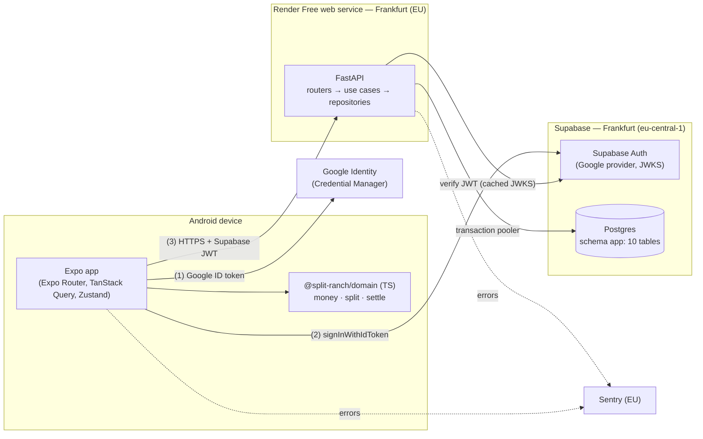
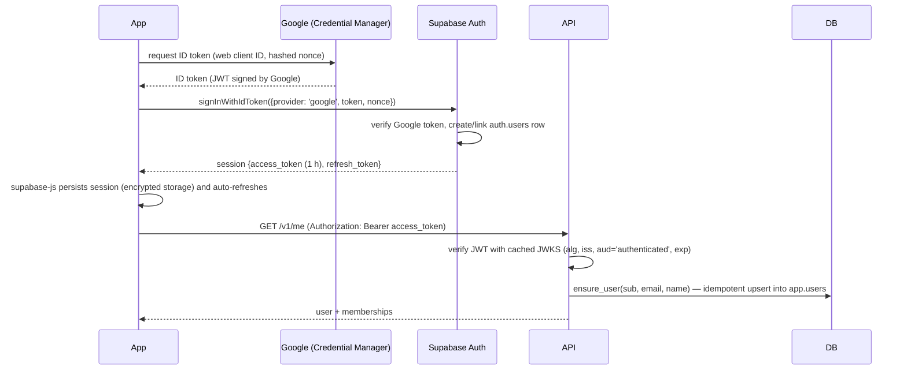
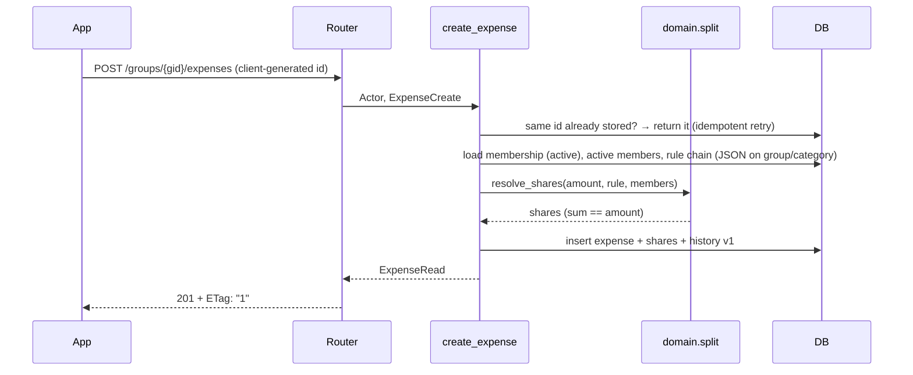

# 01 — Architecture

## Overview



One backend process: the HTTP API. **There is no background worker or job queue**: nothing the app does today needs work outside a request. Push notifications are sent to the Expo Push Service as a FastAPI background task right after the response (own DB session; failures are logged and reported to Sentry, never returned to the client), and push receipts are checked on a later send instead of by a scheduled job. Google Sheets sync is not built; when it is, it picks the lightest option that works (sending in the request, FastAPI background tasks or `pg_cron`) before considering a queue again.

**Supabase is used for exactly two things: Auth and Postgres.** The app talks to Supabase only to sign in and keep its session fresh (`supabase-js` auth client). All data reads and writes go through FastAPI. We do **not** use the Supabase Data API (PostgREST), Realtime, Storage or Edge Functions: our tables live in a private `app` schema that is not exposed, so the publishable key shipped in the app cannot read them.

## Backend layers

```
apps/api/src/split_ranch/
├── domain/            # Pure Python. No SQLAlchemy, no FastAPI, no I/O.
│   ├── money.py       # Money value object, allocate()
│   ├── split.py       # resolve rule → shares
│   └── settle.py      # balances → minimal transfers
├── schemas/           # Pydantic v2 models (strict) shared by REST and future AI tools
├── use_cases/         # Application services: one function/class per business action
├── repositories/      # SQLAlchemy queries; always scoped by group_id
├── models/            # SQLAlchemy ORM models
├── api/               # FastAPI routers: parse → call use case → serialise. No business rules.
└── core/              # settings, db session, security (Supabase JWT verification), logging, errors
```

Rules:
1. **Routers never contain business logic.** A router resolves the `Actor` (from the JWT), validates input with a Pydantic schema, calls exactly one use case, maps domain errors to HTTP problems.
2. **Use cases** receive an `Actor` (user_id + verified membership) and typed input, open a unit of work (transaction), enforce authorisation, call domain functions, persist via repositories, and record the change in `history` in the same transaction.
3. **Domain** is deterministic and pure, mirrored 1:1 in TypeScript (`packages/domain`). Parity is enforced by shared test vectors.
4. **Identity is never taken from input.** `user_id` comes from the JWT; group membership is loaded from the DB for the `group_id` in the path. A future AI tool calls the same use case with the same `Actor`.

### Use-case catalogue (initial)

| Area | Use cases |
|---|---|
| Users | `ensure_user` (first authenticated call creates `app.users` from the token claims), `update_profile`, `delete_account` (anonymise, then delete the Supabase auth user via the Admin API) |
| Groups | `create_group`, `list_groups`, `update_group`, `delete_group`, `get_or_create_invitation`, `revoke_invitation`, `accept_invitation`, `leave_group`, `remove_member` |
| Categories & rules | `create_category`, `update_category`, `archive_category`, `set_default_rule`, `set_category_rule`, `delete_category_rule` |
| Expenses | `create_expense`, `update_expense`, `delete_expense`, `list_expenses`, `get_summary`, `list_revisions`, `preview_split` |
| Balance | `compute_group_balance`, `get_balance` |
| Payments | `record_payment`, `transition_payment` (confirm, dispute, cancel), `list_payments` |

## Main flows

### Sign-in



### Create expense



### Settling up (no periods)

There is no close: each group has one running balance, recomputed on request (decided 2026-11-16).

```mermaid
sequenceDiagram
  participant A as App (debtor)
  participant B as App (creditor)
  participant U as balance / payments
  participant DB
  A->>U: GET /groups/{gid}/balance
  U->>DB: live expenses + shares, confirmed and sent payments
  U-->>A: nets (confirmed) + suggestions (greedy settle after sent payments)
  A->>U: POST /groups/{gid}/payments {id, from, to, amount} → status sent
  B->>U: POST /groups/{gid}/payments/{pid}/confirm (If-Match) → confirmed
  U->>DB: lock payment row; update; history row
```

### Quick splits (offline)

Entirely on device: the screen state is fed to `@split-ranch/domain` (`allocate` + `settle`). Nothing ever reaches the API: events are stored only in the phone (MMKV) and shared as plain text.

## Cross-cutting decisions

| Topic | Decision | Alternatives discarded |
|---|---|---|
| Deployment unit | Modular monolith | Microservices (overkill), serverless functions (cold starts, harder transactions) |
| Background jobs | None until a feature needs one; then a FastAPI background task first | A job queue (Postgres-backed or Celery + Redis): a second process to run for no current need |
| API style | REST + OpenAPI; TS client generated from OpenAPI | GraphQL (no need), tRPC (backend is Python) |
| Sync engine for offline | TanStack Query persistence + mutation queue (post-MVP: full offline) | PowerSync / WatermelonDB (powerful but heavy for the scope) |
| Auth | Supabase Auth (Google provider via native ID token); FastAPI verifies the JWT | Own JWT issuing + refresh rotation (more code and security surface); Firebase Auth (extra vendor, not where the data lives) |
| Database | Supabase Postgres, private `app` schema, accessed only by FastAPI | Render Postgres (one more provider once Auth is on Supabase); Supabase Data API + RLS directly from the app (business rules would leak into SQL policies and bypass the use-case layer) |
| Multi-tenancy | Application-level scoping (`group_id` in every query, enforced in repositories) | Postgres RLS (good later as defence in depth), DB per tenant |
| File storage | None (receipt photos are out of scope) | — |

## Hosting and environments

**Cost target: €0/month** (decided 2026-11-09). The app serves one group of two people, so there is no staging environment and every service runs on a free tier. Limits and mitigations: `infra/README.md`.

| Env | API | DB | Mobile |
|---|---|---|---|
| `dev` | local uvicorn | The cloud Supabase project (the Supabase CLI local stack in Docker still works: `pnpm db:up`) | Expo dev build, EAS channel `development` |
| `prod` | Render **Free** web service (Frankfurt), API only, auto-deploy from `main` when CI passes | Supabase project `split-ranch-prod` (Frankfurt, **Free plan**; weekly encrypted dump via GitHub Actions) | EAS `preview`/`production` APK installed directly (no Play Store) |

- **Why Supabase**: managed Postgres + Auth in the EU from one provider; Google/Apple providers by configuration; JWKS-based JWT verification; no token code to maintain. The Free plan's limits (500 MB, 50k MAU) are far above what one group needs. Its two drawbacks are covered: Free projects **pause after ~7 days of low activity** (daily use plus the daily backup job keep it active, and a paused project can be resumed from the dashboard), and Free has **no backups** (`.github/workflows/db-backup.yml`). Upgrade to Pro only if more groups join.
- **Why Render for the Python process**: a free web service in Frankfurt (same city as the database → low latency), `render.yaml` as code. Free trade-offs: the instance **spins down after 15 min idle** (~1 min cold start on the next request), and there is no pre-deploy command, so migrations run in the build. **Alternative**: Fly.io (no free tier for new accounts).
- **Database connections** (Supabase pooler, Supavisor):
  - API → **transaction mode** (port 6543), SQLAlchemy pool small, psycopg prepared statements disabled (`prepare_threshold=None`), as transaction pooling does not keep session state.
  - Migrations → **session mode** (port 5432). On Free, the direct connection is IPv6-only, so use the shared pooler (IPv4).
- **Secrets**: Render environment group (DB URLs, Supabase project URL, Supabase secret/service-role key reserved for the future `delete_account`); EAS environment variables for build-time values; never in the repo. Only the Supabase **publishable (anon) key** and project URL ship in the app. Local: `.env` files ignored by git, `.env.example` committed.
- **Observability**: structlog JSON logs with `request_id`, `user_id` (hashed), `group_id`; Sentry for API and mobile (EU region); Render metrics; Supabase dashboard (DB load, auth logs); health endpoints `/healthz` (liveness) and `/readyz` (DB check).
- **Migrations**: Alembic owns the `app` schema only (`include_schemas` filter ignores `auth`, `storage`, etc.); `alembic upgrade head` runs at the end of the Render build command (pre-deploy is paid-only) using the session-mode URL. Supabase's own migration tool is not used.

## Keeping the door open for iOS
- No Android-only APIs in shared code; platform code isolated under `src/platform/`.
- Auth abstraction `signInWithGoogle()` so Sign in with Apple can be added (App Store requires it when offering third-party login).
- Expo Push already handles APNs.
- Payment-button app list is per platform.
