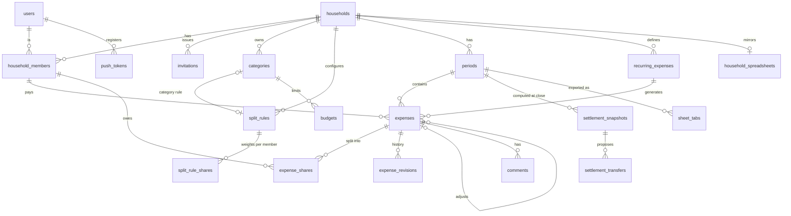

# 02 — Data model

Supabase Postgres (Frankfurt). All our tables live in the **`app` schema**, which is *not* in Supabase's exposed API schemas, and is managed exclusively by Alembic. Supabase-owned schemas (`auth`, `storage`, …) are never migrated or written by us; the only link to them is that `app.users.id` equals `auth.users.id` (the JWT `sub`). No foreign key into `auth` (keeps Alembic independent and lets us anonymise instead of cascading).

Conventions:
- Primary keys: `uuid` generated **by the client or server as UUIDv7** (time-ordered, good index locality; lets the app create IDs offline).
- Money: `bigint` cents + `currency char(3) NOT NULL DEFAULT 'EUR'` with `CHECK (currency = 'EUR')` for now.
- Timestamps: `timestamptz`, stored in UTC. Calendar dates (`expense_date`) are `date` interpreted in the household time zone.
- Soft delete: `deleted_at timestamptz NULL` on user-editable rows; queries use partial indexes `WHERE deleted_at IS NULL`.
- Optimistic locking: `version integer NOT NULL DEFAULT 1` on mutable aggregates (SQLAlchemy `version_id_col`).
- Enums: Postgres `text` + `CHECK` constraints (easier to migrate than native enums).

## ERD — household

## Quick splits — device only

Quick splits have **no server tables** (decided 2026-11-10; the `quick_*` tables were dropped in migration 0004). Each event lives only on the user's phone, in the Zustand store persisted to MMKV (`apps/mobile/src/stores/quick-splits.ts`, store version 2):

| Field | Notes |
|---|---|
| `id`, `title`, `mode` ('total','itemised'), `createdAt`, `updatedAt` | `id` is a random UUID generated on device |
| `participants[]` | `{id, name}`; order = creation order (canonical for tie-breaks); names unique case-insensitively, editable |
| `total` | Mode 1: `amountCents`, `excludedIds`, `weights`, `payerId` |
| `expenses[]` | Mode 2: `{id, description, amountCents, payerId, participantIds}`, all editable |
| `meId` | The participant who is the phone's owner ("you"), or null |
| `paidIds` | Participants marked by hand as "has paid" |

## Tables

### Identity

| Table | Key columns | Notes |
|---|---|---|
| `users` | `id` (= Supabase `auth.users.id`), `email` (citext, unique), `display_name`, `avatar_url`, `locale`, `created_at`, `deleted_at` | Created/updated by `ensure_user` from the JWT claims (`sub`, `email`, `user_metadata.full_name`, `avatar_url`). Sessions, refresh tokens and provider identities are owned by Supabase Auth — no tables of ours |
| `push_tokens` | `id`, `user_id`, `expo_token` unique, `platform`, `last_seen_at`, `disabled_at` | Disabled on `DeviceNotRegistered` receipts |

### Households

| Table | Key columns | Constraints / indexes |
|---|---|---|
| `households` | `id`, `name`, `timezone` (default `Europe/Madrid`), `currency` ('EUR'), `created_by`, `version`, `deleted_at` | `grace_days`/`auto_close` were removed with the automatic close (migration 0003) |
| `household_members` | `id`, `household_id`, `user_id`, `role` ('admin','member'), `status` ('active','leaving','left'), `display_name_override`, `sort_key` (int), `joined_period_seq` (int, period number), `left_period_seq` (int NULL, ≥ joined), `created_at` | `UNIQUE(household_id, user_id)`; partial index on active. **Expenses reference `member_id`, not `user_id`**, so history survives leaving and account deletion (anonymised) |
| `invitations` | `id`, `household_id`, `code` (8 chars, base32, unique), `created_by`, `expires_at`, `max_uses`, `uses`, `revoked_at`, `start_period` ('current','next') | Deep link `splitranch://join/{code}` + https App Link |
| `categories` | `id`, `household_id`, `name`, `icon`, `color`, `is_default`, `archived_at`, `sort_key` | `UNIQUE(household_id, lower(name)) WHERE archived_at IS NULL`. Defaults are **copied** into each household on creation |

### Split rules

| Table | Key columns | Notes |
|---|---|---|
| `split_rules` | `id`, `household_id`, `scope` ('household_default','category','recurring'), `category_id` NULL, `recurring_expense_id` NULL, `split_type`, `version`, `updated_by`, `updated_at` | `split_type` ∈ `equal`, `weights`, `percentages`, `exact`, `single`, `personal`. Partial unique indexes: one `household_default` per household; one rule per category; one per recurring expense |
| `split_rule_shares` | `split_rule_id`, `member_id`, `weight` (int, NULL), `basis_points` (int, NULL), `amount_cents` (bigint, NULL) | `percentages` stored in basis points (sum = 10 000). `single` = one row. `equal` with no rows = all active members |

### Periods and expenses

| Table | Key columns | Constraints / indexes |
|---|---|---|
| `periods` | `id`, `household_id`, `seq` (int, 1, 2, 3… per household), `status` ('open','closed','settled'), `started_at`, `closed_at`, `closed_by`, `settled_at`, `reopened_count`, `version` | `UNIQUE(household_id, seq)`; partial unique index `uq_periods_one_open (household_id) WHERE status='open'`: at most one open period. Periods are started by hand, not calendar months |
| `expenses` | `id`, `household_id`, `period_id`, `category_id`, `payer_member_id`, `amount_cents` (> 0), `currency`, `description` (≤ 140), `notes`, `expense_date`, `split_type`, `split_origin` ('override','category','recurring','household_default'), `participant_mode` ('all','subset'), `status` ('draft','confirmed'), `source` ('manual','ai_text','ai_voice','recurring','adjustment'), `source_transcript` (text NULL), `adjusts_expense_id` NULL, `recurring_expense_id` NULL, `created_by_user_id`, `updated_by_user_id`, `version`, `created_at`, `updated_at`, `deleted_at`, `deleted_reason` | Index `(household_id, period_id) WHERE deleted_at IS NULL AND status='confirmed'`; index `(household_id, expense_date DESC, id DESC)` for keyset pagination; `CHECK (source <> 'adjustment' OR adjusts_expense_id IS NOT NULL)` |
| `expense_shares` | `expense_id`, `member_id`, `amount_cents` (≥ 0), `weight` / `basis_points` / `exact_cents` (inputs kept for re-display) | PK `(expense_id, member_id)`. Deferred constraint trigger: `SUM(amount_cents) = expenses.amount_cents` (except `personal`, which has exactly one share, the payer) |
| `expense_revisions` | `id`, `expense_id`, `household_id`, `version`, `action` ('create','update','delete','restore','confirm'), `actor_user_id` (NULL = system/AI-confirmed by user), `reason` (required when period ≠ open), `before` jsonb, `after` jsonb, `created_at` | `UNIQUE(expense_id, version)`. Append-only (no UPDATE/DELETE grants for the app role) |

**Why materialise `expense_shares`?** Balances become simple `SUM`s; a later rule change does not silently rewrite history; the shares at the time of each revision are in `before/after`.

**Category rule changes** apply to expenses **created afterwards** and to existing **open-period** expenses whose `split_origin` is that category (re-resolved in one transaction, each with a revision `reason = 'rule_changed'`). Closed periods are never touched by rule changes.

### Settlement

| Table | Key columns | Notes |
|---|---|---|
| `settlement_snapshots` | `id`, `period_id`, `seq` (1, 2, …), `trigger` ('close','edit_after_close','reopen_close'), `balances` jsonb `[{member_id, paid, owed, net}]`, `transfers` jsonb, `input_hash`, `created_at`, `superseded_at` | Immutable. The latest non-superseded one is "current" |
| `settlement_transfers` | `id`, `period_id`, `snapshot_id`, `from_member_id`, `to_member_id`, `amount_cents`, `status` ('pending','sent','confirmed','disputed','cancelled'), `sent_at`, `confirmed_at`, `confirmed_by`, `note`, `version` | When a snapshot is superseded, its `pending` transfers become `cancelled` |

### Post-MVP tables (designed now, created in their phase)

| Table | Purpose |
|---|---|
| `recurring_expenses` | `household_id`, template fields (amount, category, payer, description), `schedule` (`monthly`, `day_of_month`), `split_rule` via `split_rules.scope='recurring'`, `active`, `next_run_on` |
| `budgets` | `household_id`, `category_id`, `month` NULL (= every month), `amount_cents`, `alert_thresholds` int[] (e.g. {80,100}) ; `budget_alerts_sent(budget_id, month, threshold)` for idempotent alerts |
| `comments` / `reactions` | `expense_id`, `author_member_id`, `body` / `emoji`; `UNIQUE(expense_id, member_id, emoji)` |
| `expense_approvals` | optional approval flow: `expense_id`, `member_id`, `decision`, `decided_at` |
| `household_spreadsheets` | `household_id` unique, `spreadsheet_id`, `drive_file_id`, `shared_with` jsonb, `created_at` |
| `sheet_tabs` | `household_id`, `period_id`, `sheet_id` (int), `title`, `content_hash`, `synced_at`, `status` | Idempotency for Sheets sync |
| `notifications_log` | `user_id`, `kind`, `dedupe_key` unique, `sent_at` | Avoid duplicate pushes on job retries |
| `idempotency_keys` | `user_id`, `key`, `request_hash`, `response_status`, `response_body` jsonb, `created_at` | `UNIQUE(user_id, key)`; purge after 48 h |
| `ai_usage` (AI phase) | per-user counters for quotas |

## Integrity guarantees in the database
- `amount_cents > 0` on expenses; `>= 0` on shares.
- Sum-of-shares trigger (deferred, per transaction) on `expense_shares`.
- An expense's `period_id` must belong to its `household_id` (composite FK `(period_id, household_id)` → `periods(id, household_id)`); same pattern for `payer_member_id` and `category_id`. This makes cross-tenant references impossible even with an application bug.
- The API and worker connect with a dedicated role `split_api` (not `postgres`/`service_role`) that only has privileges on the `app` schema. As defence in depth, RLS is **enabled with no policies** on every `app` table, so even if the schema were exposed by mistake, the `anon`/`authenticated` roles would read nothing; `split_api` has `BYPASSRLS`.
- `expense_revisions`, `settlement_snapshots`: append-only, enforced by revoking `UPDATE/DELETE` from `split_api` (except `superseded_at`, set via a `SECURITY DEFINER` function, or simply allow update of that one column via a trigger check).

## Migrations
- Alembic with autogenerate **reviewed by hand**; one migration per PR; naming `YYYYMMDD_HHMM_<slug>.py`.
- Expand → migrate → contract for breaking changes (add nullable column, backfill in a job, then add constraint) so the API can deploy without downtime.
- Procrastinate's queue tables are created by an Alembic migration that applies Procrastinate's schema SQL (pinned to the library version), also inside `app`.
- `env.py` sets `version_table_schema='app'` and an `include_name` filter so autogenerate never sees Supabase schemas.
- CI checks (against a plain `postgres` service container with an empty `app` schema): `alembic upgrade head` on an empty DB, `alembic downgrade -1` on the last migration, and `alembic check` (no pending autogenerate diff).
- Seed script (dev/staging only): default categories, two demo households.

## Audit and versioning summary

| Concern | Mechanism |
|---|---|
| Who changed what | `expense_revisions` with `before/after` JSON (shares included) |
| Concurrent edits | `version` + `If-Match` header → 412 Precondition Failed with current state |
| Deletion | Soft delete with `deleted_reason`; restore creates a revision |
| Settlement drift | `settlement_snapshots` per close/recalculation with `input_hash` (hash of the ordered set of `(expense_id, version)`) to detect "current calc ≠ snapshot" |
| Other aggregates (household settings, rules) | Lightweight `audit_log(entity, entity_id, actor, action, diff jsonb)` table |
