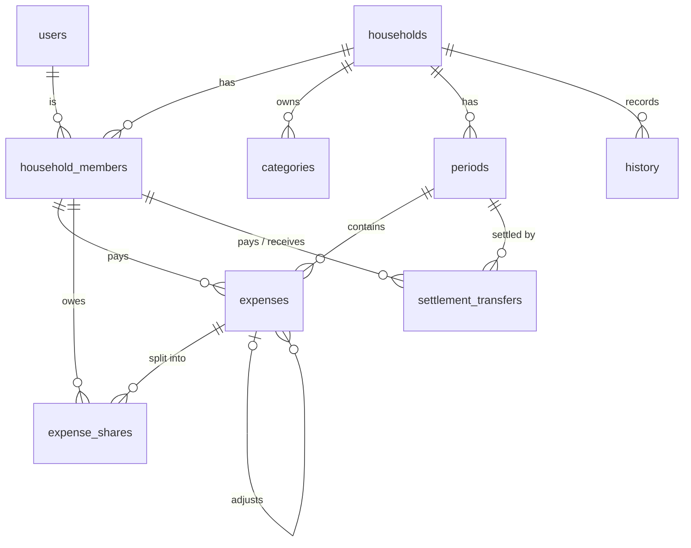

# 02 — Data model

Supabase Postgres (Frankfurt). All our tables live in the **`app` schema**, which is *not* in Supabase's exposed API schemas, and is managed exclusively by Alembic. Supabase-owned schemas (`auth`, `storage`, …) are never migrated or written by us; the only link to them is that `app.users.id` equals `auth.users.id` (the JWT `sub`). No foreign key into `auth` (keeps Alembic independent and lets us anonymise instead of cascading).

**9 tables.** The schema was simplified in migration 0005 (2026-11-11): a table exists only when a feature the app has today needs it. Tables for unbuilt features (Google Sheets, push notifications, recurring expenses, budgets…) are added in the migration of the feature that needs them, not before. See [Why these tables and no others](#why-these-tables-and-no-others).

Conventions:
- Primary keys: `uuid` generated **by the client or server as UUIDv7** (time-ordered, good index locality; lets the app create IDs offline).
- Money: `bigint` euro cents. The app only handles EUR, so there is no currency column; adding currencies later is one migration.
- Timestamps: `timestamptz`, stored in UTC. Calendar dates (`expense_date`) are `date` interpreted in the household time zone.
- Soft delete: `deleted_at timestamptz NULL` on user-editable rows; queries use partial indexes `WHERE deleted_at IS NULL`.
- Optimistic locking: `version integer NOT NULL DEFAULT 1` on expenses, periods and transfers (the rows two people may edit at once).
- Enums: Postgres `text` + `CHECK` constraints (easier to migrate than native enums).
- Small configuration that is always read whole (split rules) is **JSON** on its owner row instead of child tables.

## ERD



## Quick splits — device only

Quick splits have **no server tables** (decided 2026-11-10; the `quick_*` tables were dropped in migration 0004). Each event lives only on the user's phone, in the Zustand store persisted to MMKV (`apps/mobile/src/stores/quick-splits.ts`, store version 2):

| Field | Notes |
|---|---|
| `id`, `title`, `mode` ('total','itemised'), `createdAt`, `updatedAt` | `id` is a random UUID generated on device |
| `participants[]` | `{id, name}`; order = creation order (canonical for tie-breaks); names unique case-insensitively, editable |
| `total` | Mode 1: `amountCents`, `excludedIds`, `weights`, `payerId` |
| `expenses[]` | Mode 2: `{id, description, amountCents, payerId, participantIds}`, all editable |
| `meId` | The participant who is the phone's owner ("you"), or null |
| `paidIds` | Participants marked by hand as "has paid" |

## Tables

| Table | Key columns | Constraints / notes |
|---|---|---|
| `users` | `id` (= Supabase `auth.users.id`), `email`, `display_name`, `avatar_url`, `locale`, `created_at`, `deleted_at` | Unique `lower(email)` among live users. Created/updated by `ensure_user` from the JWT claims. Sessions, refresh tokens and identities belong to Supabase Auth |
| `households` | `id`, `name`, `timezone` (default `Europe/Madrid`), `created_by`, `split_rule` jsonb (default `{"split_type": "equal"}`), `invite_code` (8 chars base32, unique, NULL), `invite_expires_at`, `deleted_at` | `split_rule` is the household's default rule. **One join code per household**: valid 7 days, reusable by everyone invited, regenerated when it expires or is revoked |
| `household_members` | `id`, `household_id`, `user_id`, `role` ('admin','member'), `status` ('active','leaving','left'), `sort_key`, `joined_period_seq`, `left_period_seq` (NULL, ≥ joined) | `UNIQUE(household_id, user_id)`; partial index on non-left members. **Expenses reference `member_id`, not `user_id`**, so history survives leaving and account deletion (anonymised) |
| `categories` | `id`, `household_id`, `name`, `icon`, `color`, `is_default`, `archived_at`, `sort_key`, `split_rule` jsonb NULL | `UNIQUE(household_id, lower(name)) WHERE archived_at IS NULL`. Defaults are **copied** into each household on creation. `split_rule` overrides the household rule for this category (NULL = none) |
| `periods` | `id`, `household_id`, `seq` (1, 2, 3… per household), `status` ('open','closed','settled'), `started_at`, `closed_at`, `closed_by`, `settled_at`, `reopened_count`, `version` | `UNIQUE(household_id, seq)`; partial unique index `uq_periods_one_open (household_id) WHERE status='open'`: at most one open period. Members start and close periods by hand |
| `expenses` | `id`, `household_id`, `period_id`, `category_id`, `payer_member_id`, `amount_cents`, `description` (≤ 140), `notes`, `expense_date`, `split_type`, `split_origin` ('override','category','recurring','household_default'), `participant_mode` ('all','subset'), `rule_fallback`, `source` ('manual','ai_text','ai_voice','recurring','adjustment'), `adjusts_expense_id` NULL, `created_by_user_id`, `updated_by_user_id`, `version`, `created_at`, `updated_at`, `deleted_at`, `deleted_reason` | `amount_cents > 0` except adjustment reversals; index `(household_id, period_id) WHERE deleted_at IS NULL`; index `(household_id, expense_date DESC, id DESC)` for keyset pagination; `CHECK (source <> 'adjustment' OR adjusts_expense_id IS NOT NULL)` |
| `expense_shares` | `expense_id`, `member_id`, `sort_key`, `amount_cents`, `weight` / `basis_points` / `exact_cents` (inputs kept to re-edit the split) | PK `(expense_id, member_id)`. Deferred constraint trigger: `SUM(amount_cents) = expenses.amount_cents` and every share has the sign of the expense |
| `settlement_transfers` | `id`, `household_id`, `period_id`, `from_member_id`, `to_member_id`, `amount_cents` (> 0), `status` ('pending','sent','confirmed','disputed','cancelled'), `sent_at`, `confirmed_at`, `confirmed_by`, `note`, `version` | The period's **live** transfers are the non-cancelled ones. Recomputing a settlement (edit after close, reopen) cancels the pending ones and inserts new ones |
| `history` | `id`, `household_id`, `entity` ('expense','period','household','household_member','category','split_rule'), `entity_id`, `version` NULL, `action`, `actor_user_id`, `reason`, `before` jsonb, `after` jsonb, `created_at` | Append-only (a trigger rejects `UPDATE`; `split_api` has no `UPDATE/DELETE`). Expense rows carry `version` and the full `before`/`after` state (shares included): `UNIQUE(entity_id, version) WHERE entity='expense'`. Other entities store what changed in `after` |

### Split rules as JSON

A rule is the API's `SplitSpec` (discriminated on `split_type`), stored as-is:

```json
{"split_type": "equal"}
{"split_type": "weights", "shares": [{"member_id": "…", "weight": 60}, {"member_id": "…", "weight": 40}]}
{"split_type": "percentages", "shares": [{"member_id": "…", "basis_points": 6000}, …]}
{"split_type": "single", "shares": [{"member_id": "…"}]}
```

`equal` without shares = every member of the period. The API validates the JSON (members of the household, percentages summing 10 000) before storing it. Trade-off accepted: a member id inside the JSON has no foreign key; a rule that names a member who is not in the period simply does not apply and the next rule in the chain is used (`rule_fallback = true`), which the resolution logic already handled.

**Why materialise `expense_shares`?** Balances become simple `SUM`s; a later rule change does not silently rewrite history; the shares at the time of each change are in `history.before/after`.

**Rule changes** apply to expenses **created afterwards** and to existing **open-period** expenses that follow a rule (re-resolved in one transaction, each with a history row `reason = 'rule_changed'`). Closed periods are never touched by rule changes.

### Settlement without snapshots

Balances are always recomputed from the period's live expenses (deterministic; see [03](03-business-rules.md)), so they are not stored. Closing a period inserts the minimal transfers as `pending`. If the period changes before anyone pays, its pending transfers become `cancelled` and new ones are computed; cancelled rows stay as a record. Once any transfer is `sent`/`confirmed`, the period is **locked**: corrections become adjustments in the open period.

### Idempotent creation

The app generates each expense `id` (UUIDv7) before sending it. Re-sending the same expense (double tap, retry after a timeout) finds the existing row and returns it (200) instead of creating a duplicate; a different payload with the same id is a 409 `id_conflict`. No idempotency-key table is needed.

## Why these tables and no others

| Removed in 0005 | Replaced by |
|---|---|
| `split_rules`, `split_rule_shares` | `households.split_rule`, `categories.split_rule` (JSON) |
| `expense_revisions`, `audit_log` | `history` |
| `settlement_snapshots` | recomputed balances + `cancelled` transfers |
| `invitations` | `households.invite_code` / `invite_expires_at` |
| `idempotency_keys` | client-generated expense ids |
| `household_spreadsheets`, `sheet_tabs` | nothing yet: Google Sheets is not built ([06](06-google-sheets.md)) |
| `push_tokens` | nothing yet: notifications are not built |
| Job-queue tables (4) and the worker process | nothing: no background jobs exist |
| Columns `currency`, `households.version`, `household_members.display_name_override`, `expenses.status` (drafts), `expenses.source_transcript`, `expenses.recurring_expense_id` | dropped; drafts and transcripts come back with the AI phase ([07](07-future-ai.md)) |

### Future tables (created by the migration of their feature)

| Feature | Likely tables |
|---|---|
| Recurring expenses | `recurring_expenses` (template + schedule + `split_rule` jsonb); `expenses.recurring_expense_id` |
| Budgets | `budgets` (category, amount, alert thresholds) |
| Comments / reactions | `comments`, `reactions` |
| Push notifications | device tokens (a `push_tokens` table, or a jsonb column on `users` if one device per user is enough) |
| Google Sheets | spreadsheet id on `households`, a sync hash per period |
| AI | `expenses.status` ('draft','confirmed'), `expenses.source_transcript`, usage counters |

## Integrity guarantees in the database
- `amount_cents > 0` on expenses (negative only for adjustment reversals); share sums and signs checked by a deferred trigger.
- An expense's `period_id` must belong to its `household_id` (composite FK `(period_id, household_id)` → `periods(id, household_id)`); same pattern for payer, category, shares and transfers. Cross-tenant references are impossible even with an application bug.
- The API connects with a dedicated role `split_api` (not `postgres`/`service_role`) that only has privileges on the `app` schema. As defence in depth, RLS is **enabled with no policies** on every `app` table, so even if the schema were exposed by mistake, the `anon`/`authenticated` roles would read nothing; `split_api` has `BYPASSRLS`.
- `history` is append-only (trigger + no `UPDATE/DELETE` grant for `split_api`).

## Migrations
- Alembic with autogenerate **reviewed by hand**; one migration per PR; naming `YYYYMMDD_HHMM_<slug>.py`.
- Expand → migrate → contract for breaking changes (add nullable column, backfill, then add constraint) so the API can deploy without downtime.
- `migrations/sql` holds SQL used only by old migrations (0002, and 0005's downgrade): migrations are history and are never edited.
- `env.py` sets `version_table_schema='app'` and an `include_name` filter so autogenerate never sees Supabase schemas.
- CI checks (against a plain `postgres` service container): `alembic upgrade head` on an empty DB, a full downgrade/upgrade round trip, and `alembic check` (no pending autogenerate diff).

## Audit and versioning summary

| Concern | Mechanism |
|---|---|
| Who changed what | `history` rows; for expenses with full `before/after` JSON (shares included) |
| Concurrent edits | `version` + `If-Match` header on expenses → 412 Precondition Failed with current state |
| Deletion | Soft delete with `deleted_reason`; recorded in `history` |
| Settlement changes | Superseded proposals stay as `cancelled` transfers; the reason is in `history` |
