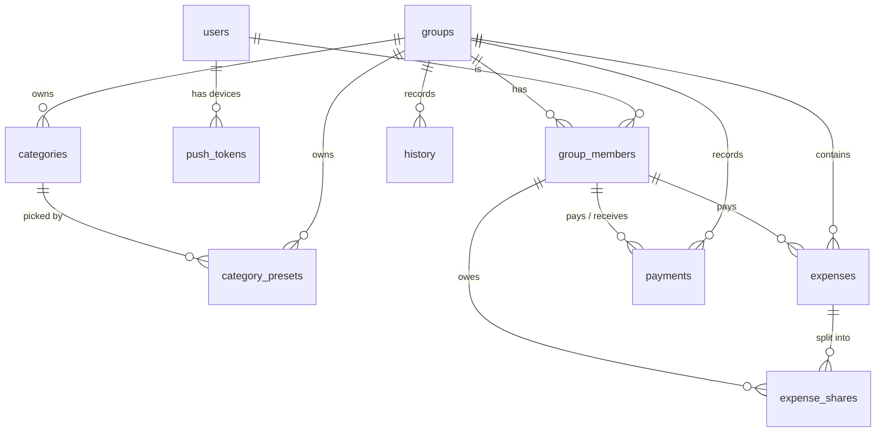

# 02 — Data model

Supabase Postgres (Frankfurt). All our tables live in the **`app` schema**, which is *not* in Supabase's exposed API schemas, and is managed exclusively by Alembic. Supabase-owned schemas (`auth`, `storage`, …) are never migrated or written by us; the only link to them is that `app.users.id` equals `auth.users.id` (the JWT `sub`). No foreign key into `auth` (keeps Alembic independent and lets us anonymise instead of cascading).

**10 tables.** Migration 0006 (2026-11-17, design: [egm/design_draft.md](egm/design_draft.md)) replaced households and periods with **groups** and one running balance: `periods` and `settlement_transfers` are gone and `payments` records what members pay each other. A table exists only when a feature the app has today needs it; migration 0010 (2026-11-19) added `category_presets` and 0011 (2026-11-19) added `push_tokens` (plus `users.notification_prefs`); tables for unbuilt features (Google Sheets, recurring expenses, budgets…) are added by the migration of that feature. See [Why these tables and no others](#why-these-tables-and-no-others).

Conventions:
- Primary keys: `uuid` generated **by the client or server as UUIDv7** (time-ordered, good index locality; lets the app create IDs offline).
- Money: `bigint` euro cents. The app only handles EUR, so there is no currency column; adding currencies later is one migration.
- Timestamps: `timestamptz`, stored in UTC. Calendar dates (`expense_date`) are `date` interpreted in the group time zone.
- Soft delete: `deleted_at timestamptz NULL` on user-editable rows (groups, expenses).
- Optimistic locking: `version integer NOT NULL DEFAULT 1` on expenses and payments (the rows two people may change at once).
- Enums: Postgres `text` + `CHECK` constraints (easier to migrate than native enums).
- Small configuration that is always read whole (split rules) is **JSON** on its owner row instead of child tables.

## ERD



## Quick splits — device only

Quick splits have **no server tables** (decided 2026-11-10; the `quick_*` tables were dropped in migration 0004). Each event lives only on the user's phone, in the Zustand store persisted to MMKV (`apps/mobile/src/stores/quick-splits.ts`, store version 2):

| Field | Notes |
|---|---|
| `id`, `title`, `mode` ('total','itemised'), `createdAt`, `updatedAt` | `id` is a random UUID generated on device |
| `participants[]` | `{id, name}`; order = creation order (canonical for tie-breaks); names unique case-insensitively, editable |
| `total` | Mode 1: `amountCents`, `excludedIds`, `weights`, `payerId` |
| `expenses[]` | Mode 2: `{id, description, amountCents, payerId, participantIds}`, all editable |
| `meId` | The participant who is the phone's owner ("you"), or null |
| `paidIds` | Participants marked by hand as "has paid" |

## Tables

| Table | Key columns | Constraints / notes |
|---|---|---|
| `users` | `id` (= Supabase `auth.users.id`), `email`, `display_name`, `avatar_url`, `locale`, `notification_prefs` jsonb, `created_at`, `deleted_at` | Unique `lower(email)` among live users. Created/updated by `ensure_user` from the JWT claims. `notification_prefs` holds the in-app switches `{enabled, expense_created, expense_changed, payments, member_joined}` (all `true` by default), read and changed through `GET/PATCH /v1/me` |
| `push_tokens` | `id`, `user_id`, `token` (Expo push token, unique), `platform` ('android','ios'), `locale` ('es','en': the app language on that device), `last_ticket_id`, `last_ticket_at`, `created_at`, `updated_at` | One row per device; `user_id` → `users` `ON DELETE CASCADE`. Registering a token another user had moves it (account switch on the same phone). `last_ticket_*` keep the latest unchecked Expo push ticket, so its receipt is read on a later send (no worker); tokens Expo reports as `DeviceNotRegistered` are deleted. See [05 §Push notifications](05-mobile-app.md#push-notifications) |
| `groups` | `id`, `name`, `timezone` (default `Europe/Madrid`), `created_by`, `split_rule` jsonb (default `{"split_type": "equal"}`), `invite_code` (8 chars base32, unique, NULL), `invite_expires_at`, `deleted_at` | A user can belong to several groups. `split_rule` is the group's default rule. **One join code per group**: valid 7 days, reusable, regenerated when it expires or is revoked. Deletion is soft (`deleted_at`) |
| `group_members` | `id`, `group_id`, `user_id`, `role` ('admin','member'), `status` ('active','left'), `sort_key`, `joined_at`, `left_at` | `UNIQUE(group_id, user_id)` (rejoining reactivates the row); partial unique index `uq_group_members_one_admin (group_id) WHERE role='admin' AND status='active'`: **exactly one active admin**. **Expenses reference `member_id`, not `user_id`**, so history survives leaving |
| `categories` | `id`, `group_id`, `name`, `icon`, `color`, `is_default`, `archived_at`, `sort_key`, `split_rule` jsonb NULL | `UNIQUE(group_id, lower(name)) WHERE archived_at IS NULL`. Defaults are **copied** into each group on creation. `split_rule` overrides the group rule for this category |
| `category_presets` | `id`, `group_id`, `category_id`, `keyword` (1–40 chars), `created_at` | `UNIQUE(group_id, lower(keyword))`; tenant-safe FK `(category_id, group_id)` → `categories` (`ON DELETE CASCADE`). A new expense whose description contains the keyword gets the category: the **app** does the matching while the description is typed (case and accents ignored, longest keyword wins); the API only stores the list. Empty by default; archiving a category deletes its presets |
| `expenses` | `id`, `group_id`, `category_id`, `payer_member_id`, `amount_cents`, `description` (≤ 140), `notes`, `expense_date`, `split_type`, `split_origin` ('override','category','recurring','group_default'), `participant_mode` ('all','subset'), `rule_fallback`, `source` ('manual','ai_text','ai_voice','recurring'), `created_by_user_id`, `updated_by_user_id`, `version`, `created_at`, `updated_at`, `deleted_at`, `deleted_reason` | `0 < amount_cents ≤ 100 000 000`; index `(group_id, expense_date DESC, id DESC)` for keyset pagination and date filters |
| `expense_shares` | `expense_id`, `member_id`, `group_id`, `sort_key`, `amount_cents`, `weight` / `basis_points` / `exact_cents` (inputs kept to re-edit the split) | PK `(expense_id, member_id)`. Deferred constraint trigger: `SUM(amount_cents) = expenses.amount_cents` |
| `payments` | `id` (client UUIDv7), `group_id`, `from_member_id`, `to_member_id`, `amount_cents`, `status` ('sent','confirmed','disputed','cancelled'), `method` ('bizum','bank_transfer','cash','other'; required by the API, NULL only on rows from before migration 0007), `note` (optional details), `created_by_user_id`, `confirmed_at`, `confirmed_by_user_id`, `version`, `created_at`, `updated_at` | `from <> to`; `0 < amount ≤ 100 000 000`; tenant-safe FKs to both members. Only `confirmed` payments count in the balance ([03 §3](03-business-rules.md#3-balance-and-payments)) |
| `history` | `id`, `group_id`, `entity` ('expense','payment','group','group_member','category','category_preset','split_rule'), `entity_id`, `version` NULL, `action`, `actor_user_id`, `reason`, `before` jsonb, `after` jsonb, `created_at` | Append-only (a trigger rejects `UPDATE`; `split_api` has no `UPDATE/DELETE`). Expense rows carry `version` and the full `before`/`after` state (shares included): `UNIQUE(entity_id, version) WHERE entity='expense'` |

### Split rules as JSON

A rule is the API's `SplitSpec` (discriminated on `split_type`), stored as-is:

```json
{"split_type": "equal"}
{"split_type": "weights", "shares": [{"member_id": "…", "weight": 60}, {"member_id": "…", "weight": 40}]}
{"split_type": "percentages", "shares": [{"member_id": "…", "basis_points": 6000}, …]}
{"split_type": "single", "shares": [{"member_id": "…"}]}
```

`equal` without shares = every **active** member when the split is resolved. The API validates the JSON (active members, percentages summing 10 000) before storing it. A rule naming a member who has since left drops them; if nobody is left, the next rule in the chain is used (`rule_fallback = true`).

**Why materialise `expense_shares`?** Balances become simple sums; a later rule change does not silently rewrite history; the shares at the time of each change are in `history.before/after`.

**Rule changes** apply only to expenses created (or explicitly re-split) afterwards. Existing expenses are never re-split by a rule change or by someone joining.

### Balance without snapshots

The running balance is always recomputed from the group's live expenses and its confirmed payments (see [03 §3](03-business-rules.md#3-balance-and-payments)), so it is not stored. Suggested payments are computed on request too.

### Idempotent creation

The app generates each expense and payment `id` (UUIDv7) before sending it. Re-sending the same row (double tap, retry after a timeout) returns the stored one (200) instead of creating a duplicate; the same id with a different payload — or an id already used in another group — is `409 id_conflict`. No idempotency-key table is needed.

## Why these tables and no others

| Removed | Replaced by |
|---|---|
| `split_rules`, `split_rule_shares` (0005) | `groups.split_rule`, `categories.split_rule` (JSON) |
| `expense_revisions`, `audit_log` (0005) | `history` |
| `settlement_snapshots` (0005) | recomputed balances |
| `invitations` (0005) | `groups.invite_code` / `invite_expires_at` |
| `idempotency_keys` (0005) | client-generated ids |
| `periods`, `settlement_transfers` (0006) | one running balance per group + `payments` |
| Columns `expenses.period_id`, `expenses.adjusts_expense_id`, `household_members.joined_period_seq` / `left_period_seq` (0006; the tables were renamed `households` → `groups`, `household_members` → `group_members`) | `group_members.joined_at` / `left_at`; edits in place instead of adjustments |
| `group_spreadsheets`, `sheet_tabs`, job-queue tables | nothing yet: those features are not built |

### Future tables (created by the migration of their feature)

| Feature | Likely tables |
|---|---|
| Recurring expenses | `recurring_expenses` (template + schedule + `split_rule` jsonb); `expenses.recurring_expense_id` |
| Budgets | `budgets` (category, amount, alert thresholds) |
| Comments / reactions | `comments`, `reactions` |
| Google Sheets | spreadsheet id on `groups`, a sync hash per exported month |
| AI | `expenses.status` ('draft','confirmed'), `expenses.source_transcript`, usage counters |

## Integrity guarantees in the database
- `amount_cents > 0` on expenses and payments; share sums checked by a deferred trigger.
- Every child row's member, category and expense must belong to the same group (composite FKs such as `(payer_member_id, group_id)` → `group_members(id, group_id)`). Cross-tenant references are impossible even with an application bug.
- At most one active admin per group (partial unique index).
- The API connects with a dedicated role `split_api` (not `postgres`/`service_role`) that only has privileges on the `app` schema. As defence in depth, RLS is **enabled with no policies** on every `app` table, so even if the schema were exposed by mistake, the `anon`/`authenticated` roles would read nothing; `split_api` has `BYPASSRLS`.
- `history` is append-only (trigger + no `UPDATE/DELETE` grant for `split_api`; migration 0006 re-applies the revoke after re-granting).

## Migrations
- Alembic with autogenerate **reviewed by hand**; one migration per PR; naming `YYYYMMDD_HHMM_<slug>.py`.
- Expand → migrate → contract for breaking changes (add nullable column, backfill, then add constraint) so the API can deploy without downtime. Exception: 0006 rebuilt the group tables on an empty database (the cloud data was test data and was reset first); it refuses to run if those tables hold rows.
- `migrations/sql` holds SQL used only by old migrations (0002, and 0005's downgrade): migrations are history and are never edited.
- `env.py` sets `version_table_schema='app'` and an `include_name` filter so autogenerate never sees Supabase schemas. Without a URL in the Alembic config it uses `DATABASE_URL_SESSION` (the cloud database): pass a local URL explicitly when experimenting.
- CI checks (against a plain `postgres` service container): `alembic upgrade head` on an empty DB, a full downgrade/upgrade round trip, and `alembic check` (no pending autogenerate diff).

## Audit and versioning summary

| Concern | Mechanism |
|---|---|
| Who changed what | `history` rows; for expenses with full `before/after` JSON (shares included); the expense shows who added and who last edited it |
| Concurrent edits | `version` + `If-Match` header on expenses and payments → 412 Precondition Failed with current state |
| Deletion | Soft delete with optional `deleted_reason`; recorded in `history` |
| Payments | Every transition (sent, confirmed, disputed, cancelled) is a `history` row |
