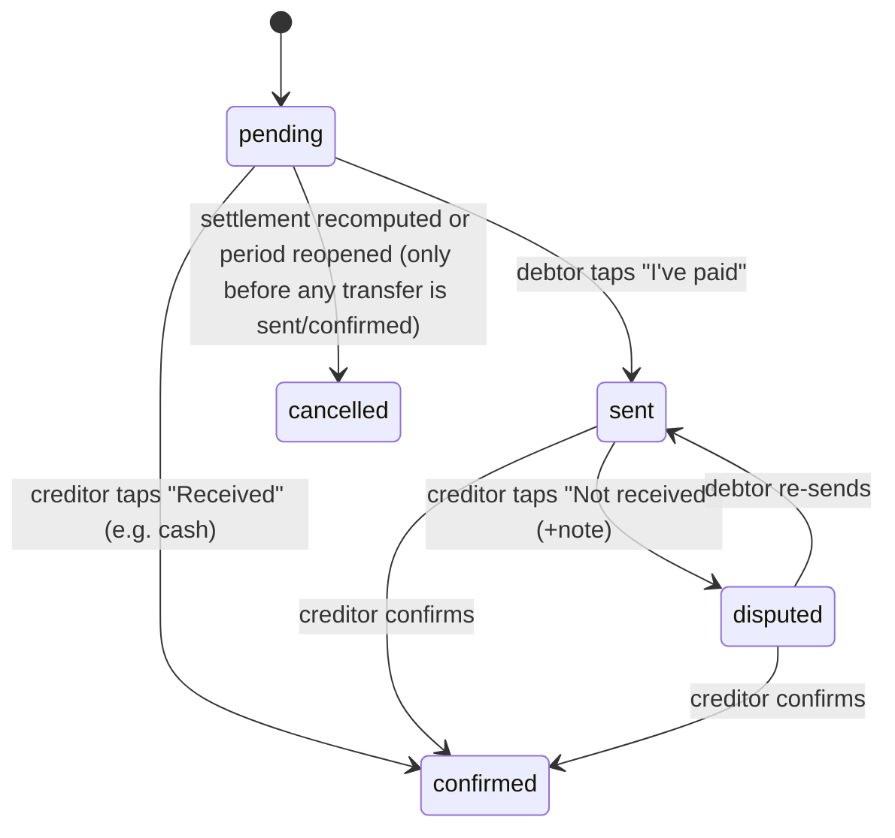
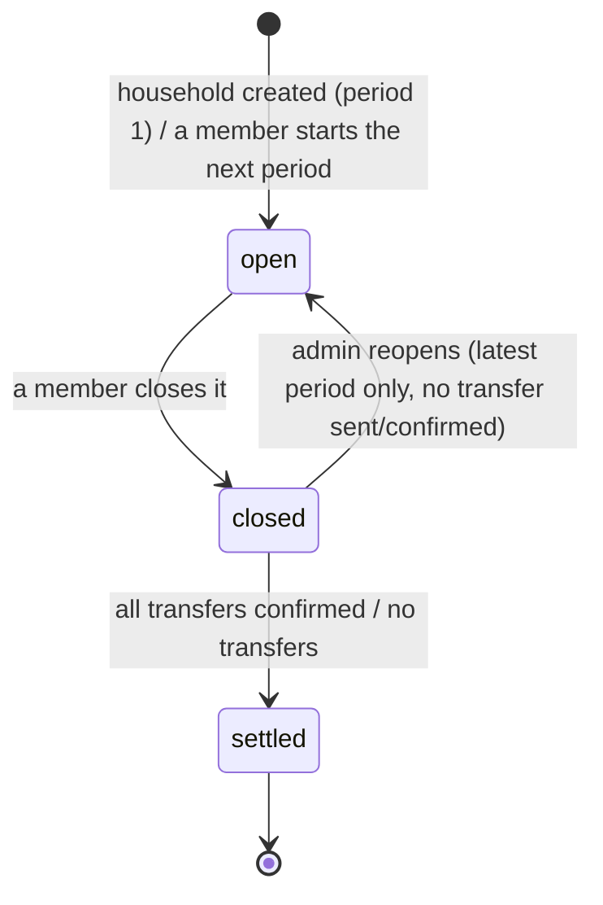

# 03 — Business rules

All amounts in this document are euros for readability; the system stores **integer cents**.

## 1. Money

### Representation
- `amount_cents: int` (Python `int`, TS `number` guarded by `Number.isSafeInteger`; max ±9·10¹⁵ cents is far beyond any household).
- Never floats. Parsing user input: string `"12,50"` → `1250` via a strict parser (comma or dot decimal separator, max 2 decimals). Formatting with `Intl.NumberFormat('es-ES', { style: 'currency', currency: 'EUR' })` on the client and `babel.numbers` (or a tiny formatter) on the server for Sheets.
- `currency` is carried everywhere but validated as `EUR`.

### Library research and decision

| Option | What it offers | Verdict |
|---|---|---|
| **Dinero.js** (`allocate(d, ratios)`) | Immutable money, integer ratios or scaled ratios; zero ratios allowed; remainder distributed **one unit at a time in ratio order** ("as evenly as possible") | Good reference, but its remainder goes to the *first* non-zero ratios, not to the ones with the largest fractional part. Pulling the full library into the domain package for one function is unnecessary |
| **py-moneyed** | `Money` + `Decimal` + currencies | Solid value object, but we do not rely on it for allocation; Decimal is unnecessary when everything is integer cents |
| Martin Fowler's *Money.allocate* | Floors each share, hands remaining cents round-robin from the start | Same order bias as Dinero |
| **Largest remainder method** (Hamilton) | Floor each share; give the leftover cents to the shares with the **largest fractional remainders**; ties broken by a stable order | **Chosen** |

**Decision:** implement our own ~25-line `allocate` in both languages using the largest remainder method with integer arithmetic only. Why: it is the fairest deterministic variant (it never gives the extra cent to someone whose exact share was further from the next cent), it is trivially portable, and it avoids two different libraries with subtly different rounding. We borrow Dinero.js's API shape (`allocate(amount, ratios)`) and its rules (ratios are non-negative integers, at least one positive, zero ratios receive zero).

Example where the choice matters: 1.01 € split with ratios 1:3. Exact shares are 0.2525 and 0.7575.
- Order-based (Dinero/Fowler): `[0.26, 0.75]`.
- Largest remainder: `[0.25, 0.76]` ← closer to the exact values.

### Algorithm

```
allocate(total: int, ratios: list[int]) -> list[int]
  require all r >= 0 and sum(r) > 0
  if total < 0: return [-x for x in allocate(-total, ratios)]
  R = sum(ratios)
  base_i = (total * r_i) // R
  frac_i = (total * r_i) %  R          # integer "fractional part" numerator
  leftover = total - sum(base_i)       # 0 <= leftover < count(frac_i > 0)
  order = indices sorted by (frac_i DESC, i ASC)
  for k in 0..leftover-1: base[order[k]] += 1
  return base
```

Properties: `sum(result) == total`; each result is `floor` or `ceil` of the exact share; zero ratios get 0; output depends only on `(total, ratios, order of inputs)`.

The **order of inputs** is always the canonical member order: `household_members.sort_key ASC, id ASC` (Quick splits: participant creation order). The domain functions receive already-ordered lists, so the tie-break is "earlier member wins".

Python (illustrative):

```python
def allocate(total: int, ratios: Sequence[int]) -> list[int]:
    if not ratios or any(r < 0 for r in ratios) or sum(ratios) == 0:
        raise InvalidRatios()
    if total < 0:
        return [-x for x in allocate(-total, ratios)]
    r_sum = sum(ratios)
    base = [total * r // r_sum for r in ratios]
    frac = [total * r % r_sum for r in ratios]
    leftover = total - sum(base)
    order = sorted(range(len(ratios)), key=lambda i: (-frac[i], i))
    for i in order[:leftover]:
        base[i] += 1
    return base
```

TypeScript (illustrative; same algorithm, `bigint` internally to avoid overflow on `total * r`):

```ts
export function allocate(total: number, ratios: readonly number[]): number[] {
  assertValidRatios(ratios);
  if (total < 0) return allocate(-total, ratios).map((x) => -x);
  const T = BigInt(total), R = ratios.reduce((a, r) => a + BigInt(r), 0n);
  const base = ratios.map((r) => (T * BigInt(r)) / R);
  const frac = ratios.map((r) => (T * BigInt(r)) % R);
  let leftover = Number(T - base.reduce((a, b) => a + b, 0n));
  const order = ratios.map((_, i) => i).sort((a, b) => (frac[b] > frac[a] ? 1 : frac[b] < frac[a] ? -1 : a - b));
  for (const i of order.slice(0, leftover)) base[i] += 1n;
  return base.map(Number);
}
```

Parity is enforced by `packages/domain-vectors/allocate.json` (see [09](09-testing-and-quality.md)).

## 2. Split engine

### Split types

| Type | Inputs | Shares |
|---|---|---|
| `equal` | participant set | `allocate(T, [1,1,…])` |
| `weights` | positive integer weight per participant (e.g. 2,1,1) | `allocate(T, weights)` |
| `percentages` | basis points per participant, **must sum to 10 000** | `allocate(T, bps)` |
| `exact` | cents per participant, **must sum to T** | as given (validation error otherwise) |
| `single` | one member | that member owes `T` (not split; may differ from payer: "Internet is paid by Franco, owed by Franco") |
| `personal` | — | payer owes `T`; **excluded from balances, settlement, shared totals and Sheets "Resumen"**; visible to others only as "private expense" (post-MVP: fully hidden) |

### Rule precedence

```
resolve_rule(expense):
  1. expense.override present          → use it                (split_origin = 'override')
  2. expense.recurring_expense rule     → use it                (split_origin = 'recurring')
  3. category rule present              → use it                (split_origin = 'category')
  4. household default rule             → use it                (split_origin = 'household_default')
  5. no default configured              → equal among period members
```

**Participant subset.** For `equal` and `weights`, the user may restrict participants when creating the expense. A restricted subset **is an override** (origin 1) even if the type is the same as the rule's. For a category/household weights rule with a subset, weights of the excluded members are dropped and the rest are used as-is (re-normalisation is implicit in `allocate`). A percentages rule with a subset is converted to weights (`bps` as weights) for the same reason.

**Rule validity.** A rule that references members not in the period (left, or not yet joined) drops them. If the remaining participants are empty, or a `single` rule points to an absent member, the engine falls back to the next level and flags the expense (`rule_fallback = true`) so admins see a warning.

### Worked example — household

Household: Juli, Franco, Ana (canonical order). Default rule: equal. Category rules: *Alquiler* 40/30/30 %, *Internet* single → Franco.

| # | Expense | Payer | Rule applied | Juli | Franco | Ana |
|---|---|---|---|---|---|---|
| E1 | Alquiler 1 200.00 | Juli | category 40/30/30 | 480.00 | 360.00 | 360.00 |
| E2 | Supermercado 100.00 | Franco | default equal: 10000/3 = 3333 r1 ×3, 1 leftover cent → first in order | 33.34 | 33.33 | 33.33 |
| E3 | Internet 40.00 | Franco | category single | 0 | 40.00 | 0 |
| E4 | Cena 60.00 | Ana | override: equal Juli + Ana | 30.00 | 0 | 30.00 |
| E5 | Gimnasio 35.00 | Ana | personal | — | — | — |

| | Juli | Franco | Ana | Σ |
|---|---|---|---|---|
| Paid (shared) | 1 200.00 | 140.00 | 60.00 | 1 400.00 |
| Owed | 543.34 | 433.33 | 423.33 | 1 400.00 |
| **Net** | **+656.66** | **−293.33** | **−363.33** | **0.00** |

Transfers (greedy, see §3): **Ana → Juli 363.33**, **Franco → Juli 293.33**.

### More allocation cases

| Total | Ratios | Result | Note |
|---|---|---|---|
| 10.00 | 1,1,1 | 3.34, 3.33, 3.33 | leftover 1 cent → first |
| 100.01 | 6000,4000 bps | 60.01, 40.00 | frac 6000 vs 4000 |
| 10.01 | 2,1,1 | 5.01, 2.50, 2.50 | frac 2,1,1 |
| 1.01 | 1,3 | 0.25, 0.76 | largest remainder beats order |
| 0.02 | 1,1,1 | 0.01, 0.01, 0.00 | fewer cents than people |
| 10.03 | 0,50,50 | 0.00, 5.02, 5.01 | zero ratio gets nothing |
| −10.00 | 1,1,1 | −3.34, −3.33, −3.33 | sign symmetry (adjustments) |

### Edge cases
- Amount 0 → rejected (`amount_cents > 0`), except adjustments which may be negative.
- Exact split not summing to total → `422 split_mismatch` with the difference.
- Payer not among participants → allowed (they paid on behalf of others).
- Payer who has left → not allowed for new expenses; historical ones keep the member.
- Very small amounts with many members → some members owe 0.00; still listed as participants.

## 3. Settlement

**Balance per member** in a period: `net = paid − owed`, considering only `confirmed`, non-deleted, non-personal expenses (adjustments included). Invariant: `Σ net = 0`.

**Minimal transfers (deterministic greedy):**

```
settle(nets: ordered list of (member, cents)) -> list[(from, to, cents)]
  creditors = members with net > 0; debtors = members with net < 0
  loop:
    c = creditor with max remaining (ties → canonical order)
    d = debtor   with max |remaining| (ties → canonical order)
    x = min(c.remaining, |d.remaining|)
    emit (d → c, x); update both; drop zeros
  until none left
```

Guarantees: at most `n − 1` transfers; cents conserved; deterministic. It is not always the global minimum (that problem is NP-hard: the optimum is `n − k`, where `k` is the maximum number of disjoint zero-sum groups).

Example where greedy is not optimal: nets A +4, B +3, C +3, D −6, E −4. Greedy → D→A 4, E→B 3, D→C 2, E→C 1 (4 transfers). Optimal → E→A 4, D→B 3, D→C 3 (3 transfers).

**Recommendation:** ship greedy in MVP. Optional improvement (households ≤ 12 members): bitmask DP to find the maximum partition into zero-sum groups (O(2ⁿ·n)), then greedy inside each group. If adopted later, existing snapshots keep their transfers; only new calculations change.

### Transfer confirmation flow



- Push to the creditor on `sent`; reminder to the debtor every 3 days while `pending` (post-MVP push).
- If the creditor has left the household, an admin may confirm with a mandatory note.
- When every live (non-cancelled) transfer of the period is `confirmed` (or there were none), the period becomes `settled`.

## 4. Period lifecycle



- **No automatic close** (decided 2026-11-09; the earlier month-end auto-close with grace days was removed). Periods are not calendar months: they are numbered per household (1, 2, 3…) and last until a member closes them.
- A new household starts with period 1 open. **At most one period is open** at a time (enforced by a partial unique index).
- **Any active member** can close the open period. Closing computes the balances and creates the minimal `pending` transfers.
- **Any active member** starts the next period (`POST /periods`) once the latest one is closed; settling the previous period can go on in parallel. Until then, new expenses are refused with `409 no_open_period`.
- New expenses go to the open period whatever their `expense_date`; the date is informational and editing it never moves an expense to another period.
- A period with no expenses closes directly to `settled`.
- Only the **latest** period can be reopened (`409 period_not_latest` otherwise), by an admin, while unlocked.

### Editing rules

| Period state | Who can edit | Requirements | Effect |
|---|---|---|---|
| `open` | author or admin | `If-Match` version | Revision; live balance updates |
| `closed`, **no transfer sent/confirmed** | author or admin | `If-Match` + **reason** (5–280 chars) | History row; previous pending transfers → `cancelled`; new transfers computed; push to members whose net changed; Sheets tab resync |
| `closed` with any transfer `sent`/`confirmed` ("locked"), or `settled` | author or admin | reason | **No in-place edit.** An **adjustment** is created in the current open period (see below) |

New expense in a closed, unlocked period (API: explicit `period_seq`): allowed with reason, same effect as an edit after close. For a locked/settled period, create it in the open period with a note instead.

### Adjustments

A correction to expense *X* of a locked period creates, in the current open period, two linked rows (both `source='adjustment'`, `adjusts_expense_id = X`):

1. **Reversal**: amount `−X.amount`, same payer, shares = exact negation of X's stored shares (no re-allocation, so it cancels X to the cent).
2. **Correction**: the corrected expense (re-resolved with the rules that applied to X, unless the user overrides). Omitted when the correction is a deletion.

Example: in locked March, Franco paid *Supermercado* 100.00 split equally (33.34/33.33/33.33). It was really 130.00. In April:
- Reversal −100.00 paid by Franco: Juli −33.34, Franco −33.33, Ana −33.33.
- Correction 130.00 paid by Franco: 43.34 / 43.33 / 43.33.
- April net effect: Franco +30.00 paid, owes +10.00 → +20.00; Juli −10.00; Ana −10.00. Σ = 0. ✓

The UI groups both rows as one "Correction of March: Supermercado (+30.00)".

### Critical review of the edit model
1. **Partial payment trap** (brief: "closed without payments → recompute"). If one transfer was already paid and an edit recomputes, cancelling/regenerating transfers would erase money that actually moved. → We lock the period at the **first `sent` or `confirmed` transfer**, not only when all are paid.
2. **Better long-term model** (recommended internally even with the product rule above): treat confirmed transfers as ledger entries of the period. Then `residual = recompute(expenses) − confirmed transfers` is always well-defined, and a future "allow edits until fully settled" policy needs no schema change. The `settlement_transfers` table already supports this.
3. **Reopen** is only allowed while unlocked; otherwise the history and Sheets would contradict real payments.
4. **Concurrency**: two admins editing the same expense → `412` with the current version; closing while someone edits → `close_period` takes `SELECT … FOR UPDATE` on the period row; an edit that loses the race receives `409 period_state_changed` and retries with the closed-period rules (reason required).
5. **Close while offline edits are queued**: the server applies the rule of the period's state *at write time*; the app shows the "reason required" sheet when the replayed mutation fails with `409 reason_required`, and asks someone to start a new period on `409 no_open_period`.
6. **Rule changes** never touch closed periods (see [02](02-data-model.md)).
7. **Recalculated settlements**: balances are always recomputed from the expenses; superseded proposals stay as `cancelled` transfers and the change (with its reason) is in `history`.

## 5. Membership changes

Product decision: **whole-period membership.** A member participates in the default splits of every period they belong to (`joined_period_seq` ≤ period ≤ `left_period_seq`).

| Event | Rule |
|---|---|
| Join (invitation accepted) | The member joins the open period; when no period is open, the next one started. When joining the open period, its expenses whose rule is "all period members" (`participant_mode='all'`) are **re-resolved** to include the new member (revision reason `member_joined`, members notified). Expenses with an explicit subset or exact amounts are untouched |
| Leave / removed | Status `leaving`, `left_period_seq` = the latest period. The member stays in that period, can still log expenses and must settle it. After the period is `settled`, status becomes `left`; they lose access to new periods but keep read access to periods they took part in |
| Leaving with debts in older periods | Allowed; transfers remain and keep notifying |
| Account deletion (GDPR) | Member row anonymised ("Former member"), shares and transfers preserved for other members' records |

See [12](12-open-questions.md) for the trade-offs of retroactive re-resolution.

## 6. Quick splits

Independent of households: no periods, no close, no adjustments, no Sheets. Same domain functions (`allocate`, `settle`). Computed on device, offline, without login. **Stored only on the user's phone**: never saved, synced or shared through the server (decided 2026-11-10). Everything stays editable at any time: event name, participant names, the total, weights, exclusions, payer, and every itemised expense.

### Mode 1 — split a total
Input: total, participants (names), optional weights/exclusions, optional payer.
Engine: one quick expense with `participants = included`, `ratios = weights (default 1)`, `payer = payer or none`.
Output: amount per person; if there is a payer, transfers from `settle`.

**Example:** dinner 87.50 €, Ana, Bea, Carlos, Dani; Carlos paid.
- `allocate(8750, [1,1,1,1])`: base 2187 each, frac 2 each, leftover 2 → Ana and Bea.
- Each: Ana 21.88, Bea 21.88, Carlos 21.87, Dani 21.87 (Σ 87.50).
- Nets: Carlos +65.63, Ana −21.88, Bea −21.88, Dani −21.87 (Σ 0).
- Transfers: Ana → Carlos 21.88, Bea → Carlos 21.88, Dani → Carlos 21.87.

**Variant:** 120.00 €, Dani excluded → 40.00 each for Ana, Bea, Carlos. With weights Ana 2 / Bea 1 / Carlos 1 → 60.00, 30.00, 30.00.

Without payer: just "each pays X" (no transfers).

### Mode 2 — itemised expenses
Input: several expenses, each with payer and participant subset.

**Example (trip):** Ana, Bea, Carlos.

| Expense | Payer | Participants | Ana | Bea | Carlos |
|---|---|---|---|---|---|
| Hotel 300.00 | Ana | all | 100.00 | 100.00 | 100.00 |
| Fuel 50.00 | Bea | Ana, Bea | 25.00 | 25.00 | — |
| Dinner 91.00 | Carlos | all (9100/3 = 3033 r1) | 30.34 | 30.33 | 30.33 |

| | Ana | Bea | Carlos | Σ |
|---|---|---|---|---|
| Paid | 300.00 | 50.00 | 91.00 | 441.00 |
| Owed | 155.34 | 155.33 | 130.33 | 441.00 |
| Net | +144.66 | −105.33 | −39.33 | 0.00 |

Transfers: **Bea → Ana 105.33**, **Carlos → Ana 39.33**.

Mode 1 is literally mode 2 with a single expense; the UI just hides the list.

### Sharing
- Text for WhatsApp (built on device), e.g.:
  ```
  🧾 Cena viernes — 87,50 €
  Cada uno: Ana 21,88 · Bea 21,88 · Carlos 21,87 · Dani 21,87
  Pagos: Ana → Carlos 21,88 €; Bea → Carlos 21,88 €; Dani → Carlos 21,87 €
  Hecho con Split Ranch
  ```
  People marked "has paid" get a ✓ after their payment (or after their share when there is no payer).
- Image: render the result card with `react-native-view-shot` and share via `expo-sharing` (post-MVP polish).
- No share links: the server never holds Quick-split data.

### Payment status (manual)
Quick splits are **not linked to any payment method** (no Bizum, PayPal.me or Revolut links). Instead, everyone who owes money has a status the user switches **by hand** with a button:

| Who | Status labels |
|---|---|
| Another participant | **Debe** ↔ **Ha pagado** |
| The phone's owner (participant marked "Soy yo") | **Debo** ↔ **Ya lo pagué** |

- "Owes money" = negative net when there is a payer; with no payer, every person with a share > 0.
- The status is a plain flag (`paidIds`): editing amounts or names never changes it; only the button does. Removing a participant clears their flag.
- One participant per event can be marked "Soy yo" in the participant dialog; it shows as "Ana (tú)".

## 7. Payments outside the app

**Decided 2026-11-10:** the app does not link to any payment platform. There is no Pay button, no Bizum/PayPal.me/Revolut links or deep links, no bank-app list, and no payment handles (phone, usernames) in profiles. People pay each other however they like, outside the app.

- Household: the debtor marks a transfer **sent** (optional note, e.g. "en efectivo"); the creditor **confirms** or **disputes** it. When every transfer is confirmed the period is settled.
- Quick splits: a manual "Debe / Ha pagado" status per person (§6).

Never claim a payment happened automatically: confirmation is always the creditor's.
