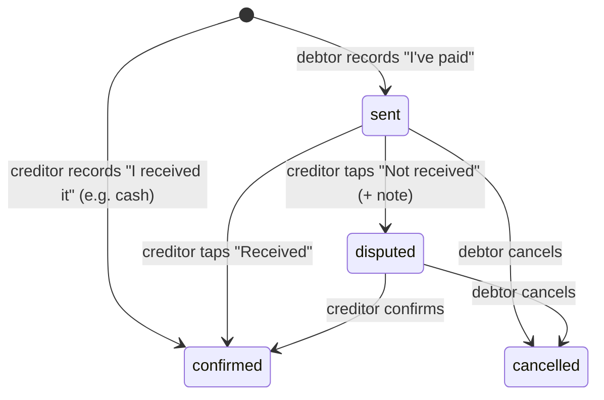

# 03 — Business rules

All amounts in this document are euros for readability; the system stores **integer cents**.

## 1. Money

### Representation
- `amount_cents: int` (Python `int`, TS `number` guarded by `Number.isSafeInteger`; max ±9·10¹⁵ cents is far beyond any group).
- Never floats. Parsing user input: string `"12,50"` → `1250` via a strict parser (comma or dot decimal separator, max 2 decimals). Formatting with `Intl.NumberFormat('es-ES', { style: 'currency', currency: 'EUR' })` on the client and `babel.numbers` (or a tiny formatter) on the server for Sheets.
- The app only handles EUR: there is no currency field.

### Library research and decision

| Option | What it offers | Verdict |
|---|---|---|
| **Dinero.js** (`allocate(d, ratios)`) | Immutable money, integer ratios or scaled ratios; zero ratios allowed; remainder distributed **one unit at a time in ratio order** ("as evenly as possible") | Good reference, but its remainder goes to the *first* non-zero ratios, not to the ones with the largest fractional part. Pulling the full library into the domain package for one function is unnecessary |
| **py-moneyed** | `Money` + `Decimal` + currencies | Solid value object, but we do not rely on it for allocation; Decimal is unnecessary when everything is integer cents |
| Martin Fowler's *Money.allocate* | Floors each share, hands remaining cents round-robin from the start | Same order bias as Dinero |
| **Largest remainder method** (Hamilton) | Floor each share; give the leftover cents to the shares with the **largest fractional remainders**; ties broken by a stable order | **Chosen** |

**Decision:** implement our own ~25-line `allocate` in both languages using the largest remainder method with integer arithmetic only. Why: it is the fairest deterministic variant (it never gives the extra cent to someone whose exact share was further from the next cent), it is trivially portable, and it avoids two different libraries with subtly different rounding. We borrow Dinero.js's API shape (`allocate(amount, ratios)`) and its rules (ratios are non-negative integers, at least one positive, zero ratios receive zero).

Example where the choice matters: 1.01 € split with ratios 1:3. Exact shares are 0.2525 and 0.7575.
- Order-based (Dinero/Fowler): `[0.26, 0.75]`.
- Largest remainder: `[0.25, 0.76]` ← closer to the exact values.

### Algorithm

```
allocate(total: int, ratios: list[int]) -> list[int]
  require all r >= 0 and sum(r) > 0
  if total < 0: return [-x for x in allocate(-total, ratios)]
  R = sum(ratios)
  base_i = (total * r_i) // R
  frac_i = (total * r_i) %  R          # integer "fractional part" numerator
  leftover = total - sum(base_i)       # 0 <= leftover < count(frac_i > 0)
  order = indices sorted by (frac_i DESC, i ASC)
  for k in 0..leftover-1: base[order[k]] += 1
  return base
```

Properties: `sum(result) == total`; each result is `floor` or `ceil` of the exact share; zero ratios get 0; output depends only on `(total, ratios, order of inputs)`.

The **order of inputs** is always the canonical member order: `group_members.sort_key ASC, id ASC` (Quick splits: participant creation order). The domain functions receive already-ordered lists, so the tie-break is "earlier member wins".

Python (illustrative):

```python
def allocate(total: int, ratios: Sequence[int]) -> list[int]:
    if not ratios or any(r < 0 for r in ratios) or sum(ratios) == 0:
        raise InvalidRatios()
    if total < 0:
        return [-x for x in allocate(-total, ratios)]
    r_sum = sum(ratios)
    base = [total * r // r_sum for r in ratios]
    frac = [total * r % r_sum for r in ratios]
    leftover = total - sum(base)
    order = sorted(range(len(ratios)), key=lambda i: (-frac[i], i))
    for i in order[:leftover]:
        base[i] += 1
    return base
```

TypeScript (illustrative; same algorithm, `bigint` internally to avoid overflow on `total * r`):

```ts
export function allocate(total: number, ratios: readonly number[]): number[] {
  assertValidRatios(ratios);
  if (total < 0) return allocate(-total, ratios).map((x) => -x);
  const T = BigInt(total), R = ratios.reduce((a, r) => a + BigInt(r), 0n);
  const base = ratios.map((r) => (T * BigInt(r)) / R);
  const frac = ratios.map((r) => (T * BigInt(r)) % R);
  let leftover = Number(T - base.reduce((a, b) => a + b, 0n));
  const order = ratios.map((_, i) => i).sort((a, b) => (frac[b] > frac[a] ? 1 : frac[b] < frac[a] ? -1 : a - b));
  for (const i of order.slice(0, leftover)) base[i] += 1n;
  return base.map(Number);
}
```

Parity is enforced by `packages/domain-vectors/allocate.json` (see [09](09-testing-and-quality.md)).

## 2. Split engine

### Split types

| Type | Inputs | Shares |
|---|---|---|
| `equal` | participant set | `allocate(T, [1,1,…])` |
| `weights` | positive integer weight per participant (e.g. 2,1,1) | `allocate(T, weights)` |
| `percentages` | basis points per participant, **must sum to 10 000** | `allocate(T, bps)` |
| `exact` | cents per participant, **must sum to T** | as given (validation error otherwise) |
| `single` | one member | that member owes `T` (not split; may differ from payer: "Internet is paid by Franco, owed by Franco") |
| `personal` | — | payer owes `T`; **excluded from balances, settlement, shared totals and Sheets "Resumen"**; other members still see it in the expense list |

### Rule precedence

```
resolve_rule(expense):
  1. expense.override present          → use it                (split_origin = 'override')
  2. category rule present              → use it                (split_origin = 'category')
  3. group default rule                 → use it                (split_origin = 'group_default')
  4. no default configured              → equal among active members
```

**Participant subset.** For `equal` and `weights`, the user may restrict participants when creating the expense. A restricted subset **is an override** (origin 1) even if the type is the same as the rule's. For a category/group weights rule with a subset, weights of the excluded members are dropped and the rest are used as-is (re-normalisation is implicit in `allocate`). A percentages rule with a subset is converted to weights (`bps` as weights) for the same reason.

**Rule validity.** A rule that references members who left the group drops them. If the remaining participants are empty, or a `single` rule points to an absent member, the engine falls back to the next level and flags the expense (`rule_fallback = true`) so members see a warning.

### Worked example — group

Group: Juli, Franco, Ana (canonical order). Default rule: equal. Category rules: *Alquiler* 40/30/30 %, *Internet* single → Franco.

| # | Expense | Payer | Rule applied | Juli | Franco | Ana |
|---|---|---|---|---|---|---|
| E1 | Alquiler 1 200.00 | Juli | category 40/30/30 | 480.00 | 360.00 | 360.00 |
| E2 | Supermercado 100.00 | Franco | default equal: 10000/3 = 3333 r1 ×3, 1 leftover cent → first in order | 33.34 | 33.33 | 33.33 |
| E3 | Internet 40.00 | Franco | category single | 0 | 40.00 | 0 |
| E4 | Cena 60.00 | Ana | override: equal Juli + Ana | 30.00 | 0 | 30.00 |
| E5 | Gimnasio 35.00 | Ana | personal | — | — | — |

| | Juli | Franco | Ana | Σ |
|---|---|---|---|---|
| Paid (shared) | 1 200.00 | 140.00 | 60.00 | 1 400.00 |
| Owed | 543.34 | 433.33 | 423.33 | 1 400.00 |
| **Net** | **+656.66** | **−293.33** | **−363.33** | **0.00** |

Transfers (greedy, see §3): **Ana → Juli 363.33**, **Franco → Juli 293.33**.

### More allocation cases

| Total | Ratios | Result | Note |
|---|---|---|---|
| 10.00 | 1,1,1 | 3.34, 3.33, 3.33 | leftover 1 cent → first |
| 100.01 | 6000,4000 bps | 60.01, 40.00 | frac 6000 vs 4000 |
| 10.01 | 2,1,1 | 5.01, 2.50, 2.50 | frac 2,1,1 |
| 1.01 | 1,3 | 0.25, 0.76 | largest remainder beats order |
| 0.02 | 1,1,1 | 0.01, 0.01, 0.00 | fewer cents than people |
| 10.03 | 0,50,50 | 0.00, 5.02, 5.01 | zero ratio gets nothing |
| −10.00 | 1,1,1 | −3.34, −3.33, −3.33 | sign symmetry (domain property; the app stores only positive amounts) |

### Edge cases
- Amount 0 or negative → rejected (`amount_cents > 0`).
- Exact split not summing to total → `422 split_mismatch` with the difference.
- Payer not among participants → allowed (they paid on behalf of others).
- Payer who has left → not allowed for new expenses; historical ones keep the member.
- Very small amounts with many members → some members owe 0.00; still listed as participants.

## 3. Balance and payments

There are **no periods** (decided 2026-11-16, design [egm/design_draft.md](egm/design_draft.md)). Each group has one **running balance** per member, from the group's creation until now:

```
net(m) =   Σ amounts of live, non-personal expenses paid by m
         − Σ m's shares in those expenses
         + Σ confirmed payments from m
         − Σ confirmed payments to m
```

Invariant: `Σ net = 0`. It is computed on every request (`use_cases/balance.py`): a confirmed payment of `x` from D to C enters the domain's `compute_balances` as an expense paid by D whose only share (`x`) is owed by C, so the TS and Python domain functions and their vectors stay unchanged. "How much did we spend last month" is not a balance question: it is a date filter on the expense list and `GET /summary`.

**Suggested payments (deterministic greedy):** the same ledger **plus the payments already `sent`** goes through `settle`, so a payment waiting for confirmation hides the suggestion it answers and nobody is told to pay twice. Suggestions are never stored.

```
settle(nets: ordered list of (member, cents)) -> list[(from, to, cents)]
  creditors = members with net > 0; debtors = members with net < 0
  loop:
    c = creditor with max remaining (ties → canonical order)
    d = debtor   with max |remaining| (ties → canonical order)
    x = min(c.remaining, |d.remaining|)
    emit (d → c, x); update both; drop zeros
  until none left
```

Guarantees: at most `n − 1` payments; cents conserved; deterministic. It is not always the global minimum (that problem is NP-hard: the optimum is `n − k`, where `k` is the maximum number of disjoint zero-sum groups).

Example where greedy is not optimal: nets A +4, B +3, C +3, D −6, E −4. Greedy → D→A 4, E→B 3, D→C 2, E→C 1 (4 payments). Optimal → E→A 4, D→B 3, D→C 3 (3 payments). An exact solver (bitmask DP, groups ≤ 12) can replace greedy later; nothing is stored, so switching changes no data.

### Payment flow



- Only the payment's debtor or creditor can record it; only the creditor confirms or disputes; only the debtor cancels. Both must be active members.
- Only `confirmed` payments count in the balance. A confirmed payment is never changed: a mistake is fixed with a payment in the opposite direction.
- Payments are idempotent by their client-generated id and use `If-Match`; every transition writes `history`.

## 4. Editing expenses

**Any active member can create, edit and delete any expense at any time** (`If-Match` against concurrent edits). There are no reasons, locks or adjustment rows: editing an old expense changes today's balance by the difference, and `history` keeps the before/after state and the author. The expense shows who added it and who last edited it.

What an edit re-splits:

| Edit | Shares |
|---|---|
| `split` or `participants` sent | Resolved again with today's rules and active members |
| Amount changed (or the payer of a `personal` expense) | Re-allocated over the **stored** participants and inputs (an equal split stays among the same people; weights keep their weights; an `exact` split must be sent again or the edit is `422 split_mismatch`) |
| Anything else (description, date, category, notes, payer) | Unchanged |

A rule change (group default or category rule) never re-splits existing expenses: it applies to expenses created or explicitly re-split afterwards.

An expense whose payer or participants include a member who **left** cannot be edited or deleted (`409 member_left`): their balance was zero when they left and must stay that way.

### Worked example — fixing an old expense

In March, Franco paid *Supermercado* 100.00 split equally (33.34/33.33/33.33), and Franco has since paid Juli what he owed. It was really 130.00. Any member edits the amount: the shares become 43.34/43.33/43.33 among the same three people, and the balances move by the difference: Franco +20.00 (paid 30.00 more, owes 10.00 more), Juli −10.00, Ana −10.00. Σ = 0.

## 5. Groups and membership

| Event | Rule |
|---|---|
| Create a group | The creator is its **admin**. 9 default categories are copied (Entertainment, Groceries, Healthcare, Home, Insurance, Rent and Services, Restaurants and bars, Shopping, Transport; "Other" = no category; the app names them in its language and lists categories alphabetically); the default rule is equal. A user can create and belong to several groups |
| Invite | **Any member** gets (or revokes) the group's 8-character code, valid 7 days, and shares it; the invitee types it in the app |
| Join | The new member takes part in expenses created from now on. Existing expenses are never re-split. Rejoining reactivates the old member row |
| Permissions | Every active member has the same rights (expenses, categories, rules, group name, invitations). Only the admin **removes members** and **deletes the group** |
| Leave / removed | Only with a zero net and no `sent`/`disputed` payment involving the member (`409 member_has_open_balance`). The member becomes `left` and loses access (404 like an outsider); their (zero) balance and history stay |
| Admin leaves | The admin role passes to the next active member in canonical order (`sort_key, id`). The last member leaving deletes the group |
| Delete the group | Admin only, confirmed by typing the group name, and only when every net is zero and no payment is waiting (`sent` or `disputed`; `409 group_has_open_balances`). Soft delete: it disappears for everyone |
| Account deletion | Only when the user could leave every live group (zero net, no `sent`/`disputed` payment in each; `409 account_has_open_balances` lists the others). In one transaction they leave each group (admin hand-over; the last member deletes the group), the `users` row is anonymised (email, name, avatar NULL, `deleted_at` set), push tokens are deleted, and then the Supabase auth user is deleted (if that fails, nothing changes). Expenses, payments and history stay and show the member as "Former member" (`account_deleted`). Signing in again with the same Google account is a new user |

## 6. Quick splits

Independent of groups: no server, no payments, no Sheets. Same domain functions (`allocate`, `settle`). Computed on device, offline, without login. **Stored only on the user's phone**: never saved, synced or shared through the server (decided 2026-11-10). Everything stays editable at any time: event name, participant names, the total, weights, exclusions, payer, and every itemised expense.

### Mode 1 — split a total
Input: total, participants (names), optional weights/exclusions, optional payer — or several payers, each with the amount they put in.
Engine: one quick expense with `participants = included`, `ratios = weights (default 1)`, `payer = payer or none`.
Output: amount per person; if there is a payer, transfers from `settle`.

**Example:** dinner 87.50 €, Ana, Bea, Carlos, Dani; Carlos paid.
- `allocate(8750, [1,1,1,1])`: base 2187 each, frac 2 each, leftover 2 → Ana and Bea.
- Each: Ana 21.88, Bea 21.88, Carlos 21.87, Dani 21.87 (Σ 87.50).
- Nets: Carlos +65.63, Ana −21.88, Bea −21.88, Dani −21.87 (Σ 0).
- Transfers: Ana → Carlos 21.88, Bea → Carlos 21.88, Dani → Carlos 21.87.

**Variant:** 120.00 €, Dani excluded → 40.00 each for Ana, Bea, Carlos. With weights Ana 2 / Bea 1 / Carlos 1 → 60.00, 30.00, 30.00.

Without payer: just "each pays X" (no transfers).

**Several payers:** the amounts entered must add up to the total; until they do there is no result ("what each person paid must add up to the total"). Shares do not change; each person's paid is what they put in, and transfers come from `settle` as usual. Example: the same dinner with Ana 50.00 and Carlos 37.50 → nets Ana +28.12, Bea −21.88, Carlos +15.63, Dani −21.87; transfers Bea → Ana 21.88, Dani → Carlos 15.63, Dani → Ana 6.24. Choosing a single payer again drops the amounts; switching to several payers starts with the single payer holding the whole total.

### Mode 2 — itemised expenses
Input: several expenses, each with payer (or several payers with the amount each put in, which must add up to the expense; otherwise the expense is not counted) and participant subset.

**Example (trip):** Ana, Bea, Carlos.

| Expense | Payer | Participants | Ana | Bea | Carlos |
|---|---|---|---|---|---|
| Hotel 300.00 | Ana | all | 100.00 | 100.00 | 100.00 |
| Fuel 50.00 | Bea | Ana, Bea | 25.00 | 25.00 | — |
| Dinner 91.00 | Carlos | all (9100/3 = 3033 r1) | 30.34 | 30.33 | 30.33 |

| | Ana | Bea | Carlos | Σ |
|---|---|---|---|---|
| Paid | 300.00 | 50.00 | 91.00 | 441.00 |
| Owed | 155.34 | 155.33 | 130.33 | 441.00 |
| Net | +144.66 | −105.33 | −39.33 | 0.00 |

Transfers: **Bea → Ana 105.33**, **Carlos → Ana 39.33**.

Mode 1 is literally mode 2 with a single expense; the UI just hides the list.

### Sharing
- Text for WhatsApp (built on device), e.g.:
  ```
  🧾 *Cena viernes*
  Total: 87,50 €
  Pagado por: Carlos

  👥 *Lo que le toca a cada uno*
  • Ana: 21,88 €
  • Bea: 21,88 €
  • Carlos: 21,87 €
  • Dani: 21,87 €

  💸 *Quién paga a quién*
  • Ana → Carlos: 21,88 €
  • Bea → Carlos: 21,88 € ✅ pagado
  • Dani → Carlos: 21,87 €
  ```
  `*…*` is WhatsApp bold. People marked "has paid" get "✅ pagado" after their payment (or after their share when there is no payer). Without a payer the "Pagado por" line and the payments section are left out; with several payers, "Pagado por" lists how much each one paid. No app branding or footer.
- No share links: the server never holds Quick-split data.

### Payment status (manual)
Quick splits are **not linked to any payment method** (no Bizum, PayPal.me or Revolut links). Instead, everyone who owes money has a status the user switches **by hand** with a button:

| Who | Status labels |
|---|---|
| Another participant | **Debe** ↔ **Ha pagado** |
| The phone's owner (participant marked "Soy yo") | **Debo** ↔ **Ya lo pagué** |

- "Owes money" = negative net when there is a payer; with no payer, every person with a share > 0.
- The status is a plain flag (`paidIds`): editing amounts or names never changes it; only the button does. Removing a participant clears their flag.
- One participant per event can be marked "Soy yo" in the participant dialog; it shows as "Ana (tú)".

## 7. Payments outside the app

**Decided 2026-11-10:** the app does not link to any payment platform. There is no Pay button, no Bizum/PayPal.me/Revolut links or deep links, no bank-app list, and no payment handles (phone, usernames) in profiles. People pay each other however they like, outside the app.

- Groups: the debtor records a payment as **sent** (optional note, e.g. "en efectivo"); the creditor **confirms** or **disputes** it (§3). A creditor can record cash received directly as confirmed.
- Quick splits: a manual "Debe / Ha pagado" status per person (§6).

Never claim a payment happened automatically: confirmation is always the creditor's.
