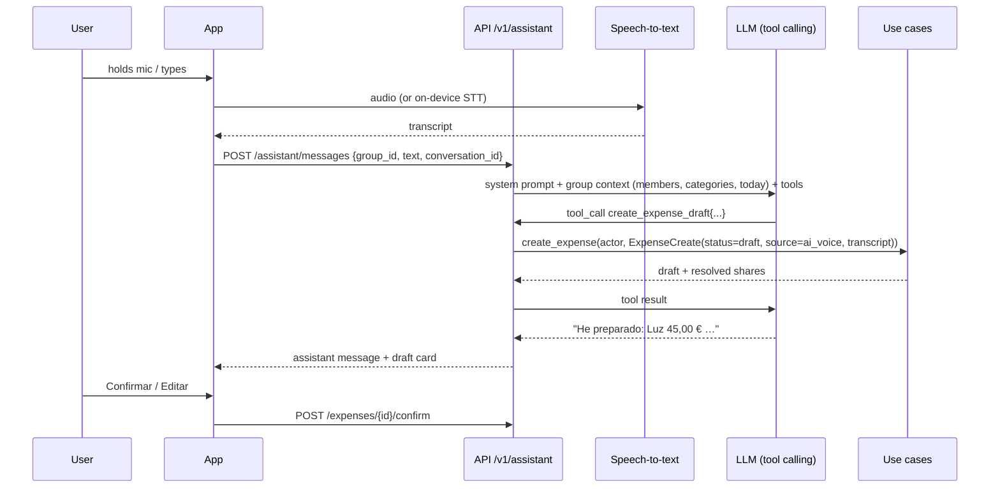

# 07 — Future AI phase (design only, not implemented)

Goal: a chat (text and voice) that records expenses for the user — "Ayer pagué 45 euros de luz, a medias con Juli" — and later answers questions ("¿cuánto llevamos en super este mes?").

## Decisions made today that enable it

| Today | Why it matters for AI |
|---|---|
| Use-case layer (`create_expense`, `preview_expense`, `get_balance`, …) | AI tools are thin adapters over the same functions; no duplicated rules |
| Strict Pydantic schemas (`extra="forbid"`, discriminated split union) | Become the JSON Schemas of the tools; LLM output validated exactly like REST input |
| `expenses.status = 'draft'` | "AI proposes, user confirms": tool creates a draft, user confirms in the UI |
| `expenses.source` (`ai_text`, `ai_voice`) + `source_transcript` | Traceability, evaluation, and the ability to show "created from: …" |
| Identity from JWT only | The model can never choose `user_id`/`group_id`; the tool runtime injects the `Actor` |
| `POST /expenses/preview` | Lets the assistant show the resolved split before saving |
| Revisions table | Every AI-originated change is auditable and reversible |
| Client-generated ids | Safe retries when the model repeats a tool call (creating the same expense id twice returns the stored one) |

## Flow

## Tools (initial set)

| Tool | Maps to | Writes? |
|---|---|---|
| `list_members`, `list_categories` | read repositories | no |
| `preview_expense` | `preview_expense` | no |
| `create_expense_draft` | `create_expense(status='draft')` | draft only |
| `update_expense_draft` | `update_expense` on own drafts | draft only |
| `get_balance(month?)` | `get_balance` | no |
| `search_expenses(filters)` | `list_expenses` | no |

Hard rules: the assistant **never confirms** expenses, edits confirmed expenses, deletes groups or records payments. Those require the UI.

## Limits and safety
- Per-user quotas (e.g. 50 assistant messages/day, 10 min audio/day) stored in `ai_usage`; per-group monthly cost cap.
- Max tool calls per turn (e.g. 5); max drafts per message (e.g. 5).
- Transcripts stored only with the expense (`source_transcript`), retention aligned with the expense; raw audio not stored by default.
- Prompt-injection surface is small (user's own text), but expense descriptions from other members are treated as data in context.
- Provider choice deferred; prefer an EU-hosted or EU-data-processing option for GDPR; STT on-device (Android `SpeechRecognizer`) as the cheapest first step.

## Evaluation
- Golden set of ~200 utterances (Spanish, regional variants, amounts like "cuarenta y cinco con cincuenta", "a medias", "lo pago yo", relative dates) → expected `ExpenseCreate` JSON.
- Metrics: exact-match on amount/payer/date, category accuracy, split accuracy, draft acceptance rate in production, edit-before-confirm rate.
- Offline eval in CI (nightly) against the chosen model; regression gate when changing prompt/model.

## Later ideas (not committed)
Automatic categorisation suggestions on manual entry, anomaly detection ("this electricity bill is 2× usual"), monthly insights.
