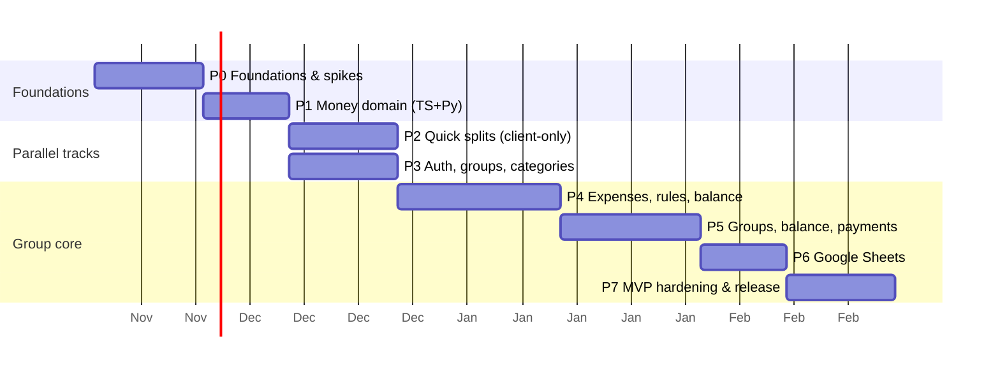

# 10 — Roadmap

Estimates assume **1 full-stack developer** (≈ 1.6× faster with 2). "w" = working weeks. Each task (`T-x.y`) is sized to become one issue/prompt: it states its goal and acceptance criteria (AC).

**MVP ≈ 14–16 weeks** for one developer (P2 overlaps when a second person is available; otherwise P2 can ship right after P1 as an early public release).

## P0 — Foundations and spikes (2 w)

| Task | AC |
|---|---|
| T-0.1 Monorepo scaffold (pnpm workspaces, uv, folders per [11](11-repo-structure.md)) | `pnpm i` and `uv sync` work; `pnpm db:up` starts the local Supabase stack; `pnpm api:dev` connects to it |
| T-0.2 CI skeleton | ci.yml runs lint/type/test for empty packages; gitleaks; branch protection |
| T-0.3 **UI stack spike** on Expo SDK 58: NativeWind 4.2 + Tailwind 3 + React Native Reusables (Button, Dialog, Select, Tabs), dark mode, font scaling | Dev build on a real Android device; decision recorded (go / fallback SDK 57 / Uniwind) in [13](13-design-system.md) |
| T-0.4 **Google sign-in spike** (Universal Sign-In vs free Credential Manager lib) → `supabase.auth.signInWithIdToken` + FastAPI JWKS verification | Real device signs in to the Supabase project; a FastAPI endpoint accepts the Supabase token and rejects anon/expired ones; library choice + licence cost recorded (2026-11-12: `react-native-nitro-google-signin`, MIT, €0; nonce enforced; sign-in verified on the Android emulator dev client, physical phone pending) |
| T-0.5 FastAPI skeleton: settings, structlog, Sentry, `/healthz` `/readyz`, SQLAlchemy 2 async session, Alembic init | Tests green |
| T-0.6 Supabase prod project (Frankfurt, **Free plan**; Google provider; `app` schema, `split_api` role, Data API not exposing `app`) + Render Free web service (`render.yaml`: API only, no background worker; migrations run in the build) + EAS project (`development`/`preview`) + weekly backup workflow | URL responds and reaches the DB via the shared pooler; preview APK installs; backup artifact produced |

Risks: version incompatibilities (mitigated by spikes and pinning).

## P1 — Money domain (1.5 w)

| Task | AC |
|---|---|
| T-1.1 `allocate` in Python and TS | All vectors in `allocate.json` pass in both; property tests green |
| T-1.2 `resolve_shares` (all split types, subsets, fallback) | Vectors + properties; examples from [03](03-business-rules.md) reproduced exactly |
| T-1.3 `settle` (greedy, deterministic) | Vectors + properties; group and quick-split examples reproduced |
| T-1.4 Money parse/format helpers (es-ES) | `"1.234,56"`, `"12,5"`, `"12.50"` parsed; invalid inputs rejected |
| T-1.5 Random vector generator + nightly parity job | CI fails on any divergence |

## P2 — Quick splits (2 w) — independent module

Depends only on P1 (+ P0 UI). Can ship before or in parallel with P3–P5.

| Task | AC |
|---|---|
| T-2.1 Local store (Zustand + MMKV) for quick events | Events survive app restart; no network calls |
| T-2.2 Mode 1 UI (total, participants, weights/exclude, optional payer) | 87,50 € example gives 21,88/21,88/21,87/21,87 and correct transfers |
| T-2.3 Mode 2 UI (itemised expenses) | Trip example from [03](03-business-rules.md) reproduced |
| T-2.4 Share as text (WhatsApp) | Text format as specified; uses `Share` API |
| T-2.5 Access without login from sign-in screen | Fresh install → Quick splits usable offline in airplane mode |
| ~~T-2.6 Save/sync to account~~ | **Dropped 2026-11-10**: Quick splits stay on the phone only |
| T-2.7 Manual payment status ("Debe / Ha pagado"; "Debo / Ya lo pagué" for "Soy yo") | Button toggles the status; edits never change it; share text shows ✓ |

## P3 — Auth, groups, categories (2 w)

| Task | AC |
|---|---|
| T-3.1 `get_actor` dependency (JWKS cache, claim checks) + `ensure_user` + `GET/PATCH /me` | Unit tests with locally signed ES256 test tokens: valid, expired, wrong `iss`/`aud`, `anon` role, `HS256`; first call creates `app.users` |
| T-3.2 Supabase config as code (`supabase/config.toml` for local; documented dashboard settings for the cloud project: only Google provider, anonymous sign-ins off, token lifetime) | Fresh local stack reproduces the config; checklist ticked for the cloud project |
| T-3.3 App auth flow (sign-in screen, `signInWithGoogle` → Supabase, encrypted MMKV session storage, AppState auto-refresh, Stack.Protected) | Kill app → reopen stays signed in; sign-out → back to sign-in; expired token transparently refreshed |
| T-3.4 Groups + members + roles + default categories | Create group → admin; 9 default categories copied |
| T-3.5 Invitations (code typed by hand; App Links later) | Second device joins with the code; expired handled |
| T-3.6 Tenant-isolation test harness | Every group route returns 404 for outsiders |
| T-3.7 Categories CRUD + archive (admin) | Archived categories hidden from pickers but kept on old expenses |

## P4 — Expenses, rules, live balance (3 w)

| Task | AC |
|---|---|
| ~~T-4.1 Periods~~ | Dropped 2026-11-16 (no periods) |
| T-4.2 Split rules: group default + category rules (API + admin UI) | 60/40 rule must sum 100 %; live validation |
| T-4.3 `create_expense` use case + revisions + idempotency | Shares persisted; revision v1; replay with same key returns same response |
| T-4.4 Update/delete with If-Match (any member) | Stale version → 412 with current data; UI shows conflict sheet |
| T-4.5 Expense form (amount keypad, category chips, payer, date, split section with live preview using the TS domain) | Preview equals server shares in 100 % of vector cases |
| T-4.6 Expense list (FlashList, filters, cursor pagination) + detail + history | 1 000 expenses scroll smoothly on a mid-range device |
| T-4.7 Live balance endpoint + home card | Σ nets = 0; matches the group example |
| T-4.8 Personal expenses (split type) | Excluded from balance and totals |
| T-4.9 Offline create queue (MVP offline) | Airplane mode → create → reconnect → exactly one expense |

## P5 — Groups without periods, balance and payments (replaces "Period close, settlement")

Decided 2026-11-16; design and review in [egm/design_draft.md](egm/design_draft.md) and [egm/consolidated_review_report.md](egm/consolidated_review_report.md). The period tasks of P4/P5 (T-4.1, T-5.1 – T-5.8) are **dropped**: built, then removed by migration 0006.

| Task | AC | Status |
|---|---|---|
| T-5.10 Migration 0006: groups, members with `joined_at`/`left_at`, one admin, `payments`; drop periods, transfers, adjustments | Round trip + `alembic check` green; refuses non-empty tables | Done |
| T-5.11 Running balance + suggestions (`compute_group_balance`, payments as ledger rows, suggestions after sent payments) | docs/03 example: nets +656,66 / −293,33 / −363,33; Σ nets 0 | Done |
| T-5.12 Payments: record (debtor → sent, creditor → confirmed), confirm / dispute / cancel, If-Match, history, idempotent id | State machine tests; only the receiver confirms | Done |
| T-5.13 Flat permissions: any member edits expenses, categories, rules, group, invitations; admin removes members and deletes the group | Permission tests | Done |
| T-5.14 Leave / remove only at zero balance; admin hand-over; last member deletes the group; rejoin | `409 member_has_open_balance`; tests | Done |
| T-5.15 Expense edit rule (only `split`/`participants` re-split; amount re-allocates over stored participants; `member_left`) | CUJ 6 example: +20,00 / −10,00 / −10,00 | Done |
| T-5.16 Date filters + `/summary` (same filters) | Last month = inclusive date range in the group time zone | Done |
| T-5.17 Mobile: group list/switcher, home balance, settle up, expense list by day with month chips and totals, edit/delete expense, group settings | Typecheck + unit tests; manual CUJ 1 → 7 on two phones | Done (manual check pending) |
| T-5.18 Mobile: date picker, weights/percentages/exact split editor, categories & rules screens | Preview equals server shares | Done |

## P6 — Google Sheets (1.5 w) — pending redesign: one tab per calendar month instead of per period ([06](06-google-sheets.md))

| Task | AC |
|---|---|
| T-6.1 Service account + user-owned spreadsheet shared with it as Editor (runbook in `infra/README.md`) | Service account can write a cell in the spreadsheet |
| T-6.2 `ensure_group_spreadsheet` (verify access, write `Léeme`) | Missing share → clear error state, no crash |
| T-6.3 Pure renderer for the 4 tabs + content hash | Snapshot tests |
| T-6.4 `sync_month_tab` with backoff and error states | Simulated 429 → retries and succeeds; unchanged hash → no API calls |
| T-6.5 Triggers: on demand and when a month is over (background task after the commit) | Edits to an exported month resync only that tab |
| T-6.6 Sheets status in app settings | Shows last sync / error |

## P7 — MVP hardening and release (2 w)

| Task | AC |
|---|---|
| T-7.1 Privacy policy, account deletion (in-app + web URL), data export | Play Console data-safety form completed |
| T-7.2 Sentry release tracking (API + mobile source maps) | Errors show readable stacks |
| T-7.3 Maestro E2E: sign-in (test account), create group, add expenses, record and confirm a payment | Green in CI |
| T-7.4 Prod environment (free tiers; restore drill of the GitHub Actions backup into the local stack) | Restore tested |
| T-7.5 APK installed directly on both phones (no Play Store) | A month of real expenses, settled up with payments |
| T-7.6 Accessibility & i18n pass (es/en) | Checklist in [13](13-design-system.md) passes |

## Post-MVP — ordered by value / effort

| # | Feature | Value | Effort | Notes / dependencies |
|---|---|---|---|---|
| 1 | ~~Push notifications~~ | — | — | **Done**: expense created/edited/deleted and payment events, per-type switches in Settings ([05](05-mobile-app.md#push-notifications)) |
| 2 | ~~Recurring expenses~~ | — | — | **Dropped 2026-11-26**: not going to be built |
| 3 | ~~Payment button~~ | — | — | **Dropped 2026-11-10**: the app never links to payment platforms |
| 4 | ~~Private expenses visibility~~ | — | — | **Dropped 2026-11-26**: `personal` expenses stay visible to every member |
| 5 | ~~Multi-group UI~~ | — | — | **Done** in T-5.17 (group list, open a group from the route) |
| 6 | ~~Budgets per category + alerts~~ | — | — | **Dropped 2026-11-26**: not going to be built |
| 7 | ~~Charts, month-over-month, CSV/PDF export~~ | — | — | **Dropped 2026-11-26**: the Insights screen stays as it is; a later export goes through Google Sheets ([06](06-google-sheets.md)) |
| 8 | ~~Quick-split result as image~~ | — | — | **Dropped 2026-11-26**: the result is shared as text only |
| 9 | ~~Comments/reactions + optional approval flow~~ | — | — | **Dropped 2026-11-26**: not going to be built |
| 10 | **Full offline sync** | Medium | L (3 w) | Outbox, change feed, conflict UI |
| 11 | ~~Home-screen widget / quick add~~ | — | — | **Dropped 2026-11-26**: no widget and no "Nuevo gasto" app shortcut |
| 12 | **AI phase** | High (differentiator) | L | See [07](07-future-ai.md); after push |
| — | iOS | — | M | Sign in with Apple, APNs via Expo, store review |

## Dependencies summary
P1 → P2, P3 · P3 → P4 → P5 → P6 → P7 · Push (done) → reminders.

## Main risks

| Risk | Likelihood | Impact | Mitigation |
|---|---|---|---|
| UI library churn (NativeWind v5 RC, SDK 58 new) | Medium | Medium | Spike T-0.3, pin versions, Reusables supports NativeWind and Uniwind |
| Google Sign-In library/licensing | Medium | Medium | Spike T-0.4, abstraction layer |
| Sheets quotas/ownership | Low | Low (non-blocking) | User-owned file shared with the service account, monthly tabs, hashes |
| Free-tier limits (Render cold start, Supabase pause, no managed backups) | Medium | Medium | No worker or queue (pushes go out right after the response, so a spin-down after 15 min idle loses nothing), weekly backup job as a safety net against pausing, resume runbook (`infra/README.md`) |
| Rules complexity confuses users | Medium | High | Show "why this split" (`split_origin`) everywhere; sensible defaults |
| Edits after close / adjustments misunderstood | Medium | Medium | Diff UI, clear copy, E2E tests |
| Solo developer bandwidth | High | High | Strict phase gates; Quick splits as early release to validate UI stack |
