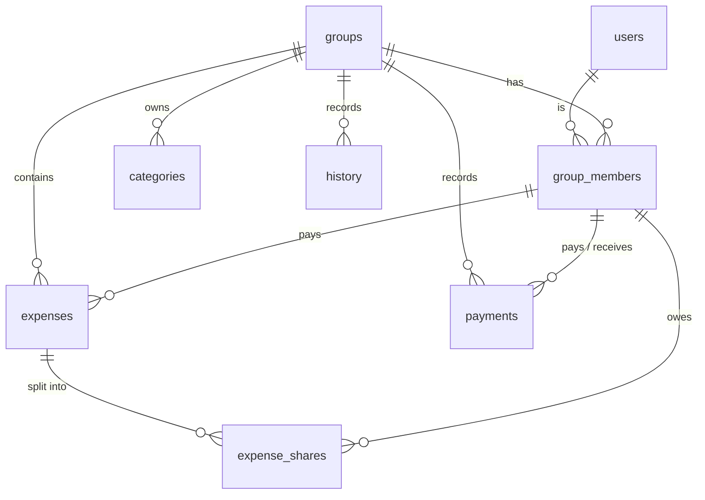

# Groups without periods

*   **Author:** franco
*   **Status:** Approved (v2, review fixes applied)
*   **Date:** 2026-11-16

--------------------------------------------------------------------------------

## Overview

Splitranch today organises a household's shared expenses into numbered
**periods**: a member closes the open period, the server turns the balances
into transfers, people mark them sent and confirmed, and someone starts the
next period. Editing an expense of a closed period needs a reason; once a
transfer is sent the period is locked and corrections become two-row
adjustments.

This design removes periods. A user creates **groups** and invites other users
with the group's code. All members have the same permissions, except that the
group's single **admin** (its creator) is the only one who can delete the group
and remove another member. Each expense records who paid, who added it, its
date and its category, so the list is grouped by day and filtered by date
range: "how much did we spend last month" is a filter. Each member has one
**running balance** in each group, from the group's creation until now. To
settle, a debtor records a **payment**; it counts once the creditor confirms
it.

"Household" becomes "group" in every layer: tables, API routes, Python and
TypeScript modules, and UI text.

## The Problem

1.  **Somebody must close and start periods.** If nobody starts the next
    period, new expenses fail with `409 no_open_period`.
2.  **Editing old expenses has three rules** (open, closed-unlocked,
    locked/settled), with reasons, recomputed transfers and reversal rows. The
    rules are hard to explain and carry about 450 lines in
    `use_cases/periods.py` plus the adjustment code in `use_cases/expenses.py`.
3.  **Membership is tied to period numbers** (`joined_period_seq`,
    `left_period_seq`, status `leaving`). Joining re-splits earlier expenses of
    the open period; leaving lasts until the period settles.
4.  **"Last month" is not something the data answers.** Periods are numbered,
    not calendar months.
5.  **Only admins edit rules, categories and other people's expenses.** In a
    group of flatmates this makes one person a bottleneck.
6.  **One household per user is too narrow.** The same person shares a flat
    with some people and a trip with others; each needs its own group, and a
    finished trip should be deletable.

The design keeps the money domain (`allocate`, `resolve_shares`,
`compute_balances`, `settle`, in Python and TS with shared vectors),
materialised shares, `If-Match` versions, idempotent creation, append-only
`history` and tenant-safe composite foreign keys, and removes the period layer
on top of them.

## Goals

*   A user can create several groups, switch between them, and invite people
    with the group's 8-character code (valid 7 days, as today). Any member can
    get or revoke the code; the invitee types it in the app.
*   Any active member can create, edit and delete any expense at any time, and
    edit categories, split rules and the group's name and time zone. Every
    change writes a `history` row with its author.
*   Each group has exactly one active admin. Only the admin deletes the group
    and removes another member. When the admin leaves, the role passes to the
    next active member in canonical order (`sort_key, id`).
*   The expense list is grouped by `expense_date`, newest first, and filters by
    date range (this month, last month, custom), category, payer, author and
    text. `GET /summary` returns the total and the totals per category and per
    payer for exactly the same filters.
*   Each member has one running balance per group: all live, non-personal
    expenses plus all confirmed payments. The balances always sum to 0.
*   The app suggests payments with the existing greedy `settle` (at most
    _n − 1_ payments; not always the global minimum, see
    [03 §3](../03-business-rules.md#3-settlement)). Suggestions are computed on
    request and never stored.
*   A debtor records a payment (`sent`); the creditor confirms or disputes it.
    A creditor may record cash received directly as `confirmed`.
*   `packages/domain`, `split_ranch/domain` and `packages/domain-vectors` do not
    change.

## Non-Goals

*   Google Sheets export ([06](../06-google-sheets.md) is marked "pending
    redesign").
*   Freezing old expenses (no locks, no settle-up cut-offs).
*   Android App Links and a `join/[code]` route (D4: codes are typed by hand).
*   Enforcing `X-Min-App-Version` in the app (both phones are updated by hand).
*   Offline edits, push notifications.
*   Drift-report items this change does not touch (rate limiting, account
    deletion, mobile Sentry, OpenAPI client generation, …).

## Decisions

Recorded in [12-open-questions.md](../12-open-questions.md) on 2026-11-16.

| # | Decision |
|---|---|
| Q1 | A rule change applies only to expenses created (or explicitly re-split) afterwards. |
| Q2 | "Everyone" in an equal split = the active members when the split is resolved. An amount-only edit re-allocates over the participants and inputs already stored; only an edit of `split` or `participants` resolves again. |
| D1 | Exactly one active admin per group, automatic hand-over to the next active member when the admin leaves. If the admin is the last member, leaving deletes the group. Manual role change is removed. |
| D2 | Leaving and removal require the member's net to be 0 (`409 member_has_open_balance`). Deleting a group requires every net to be 0 (`409 group_has_open_balances`). An edit or payment can therefore never change the balance of a member who has left: their net was 0 and they are in no new expense. Editing an old expense that has a left member as payer or participant is refused with `409 member_left`. |
| D3 | The cloud database holds test data only (2 users, 5 expenses). It is reset before migration 0006; 0006 refuses to run if `app.households`, `app.periods`, `app.expenses` or `app.settlement_transfers` hold rows, so no data mapping is designed. |
| D4 | Invitations by code typed in the app. |
| R1 | Payments: `sent → confirmed / disputed / cancelled`, `disputed → confirmed / cancelled`; no re-send (the debtor cancels and records a new one). |
| R2 | Rename every layer once, inside `/v1` (single client, updated by hand). |

## Critical User Journeys (CUJs)

### CUJ 1: Create a group and invite a flatmate

*   **Given**: Franco is signed in with no groups.
*   **When**: He creates "Piso Madrid", taps "Invite" and sends the code on
    WhatsApp; Juli signs in, taps "Join with code" and types it.
*   **Then**: Franco is admin and Juli member; 12 default categories exist; the
    default rule is equal; Juli can herself get the code to invite someone.

### CUJ 2: Log an expense

*   **Given**: Franco and Juli are in "Piso Madrid".
*   **When**: Juli adds "Supermercado 60,00 €", paid by her, today.
*   **Then**: It appears under today's header with "Juli · added by Juli";
    Franco's balance is −30,00 € and Juli's +30,00 €.

### CUJ 3: Last month's spending

*   **Given**: Expenses in October and November.
*   **When**: Franco picks "Last month" in the list.
*   **Then**: Only October expenses, grouped by day, under a header with the
    October total and totals per category and payer (personal excluded). The
    balance on the home screen does not change.

### CUJ 4: Settle up

*   **Given**: Franco −293,33 €, Juli +293,33 €.
*   **When**: Franco opens "Settle up", taps the suggestion "Franco → Juli
    293,33 €", adds the note "Bizum" and records it.
*   **Then**: The payment is `sent`; the balances do not change and the
    suggestion disappears ("293,33 € pending confirmation"). Juli taps
    "Received": the payment is `confirmed` and both balances are 0,00 €.

### CUJ 5: Dispute

*   **Given**: Franco recorded a payment of 50 € that Juli did not receive.
*   **When**: Juli taps "Not received" with a note.
*   **Then**: The payment is `disputed`; the suggestion comes back. Franco can
    cancel it and record a new one.

### CUJ 6: Fix an old expense

*   **Given**: A three-month-old expense of 100,00 € should be 130,00 €.
*   **When**: Any member edits the amount.
*   **Then**: The expense is updated in place (`If-Match`), its participants and
    weights are kept and the 130,00 € are re-allocated over them; a `history`
    row records before/after and the author; the balances move by the
    difference.

### CUJ 7: The admin deletes the group

*   **Given**: Franco is admin of "Viaje Lisboa" and every balance is 0.
*   **When**: He deletes it, confirming with the group name.
*   **Then**: It disappears for everyone; opening it returns 404. Juli never sees
    the action; the API answers her `403 forbidden_role`. With a non-zero
    balance the API answers `409 group_has_open_balances`.

## Technical Plan (Architecture)

### Data model (8 tables, down from 9)



| Table | Change |
|---|---|
| `groups` (was `households`) | Same columns. |
| `group_members` (was `household_members`) | `group_id`; status `active` / `left`; `joined_at timestamptz NOT NULL`, `left_at timestamptz NULL` replace the period sequence columns; partial unique index: one `admin` per group among `active` members. |
| `categories` | `group_id`. |
| `periods` | Dropped. |
| `expenses` | `group_id`; no `period_id`; `split_origin` value `group_default`; `source` no longer allows `adjustment` and `adjusts_expense_id` is dropped (the table is empty, D3). |
| `expense_shares` | `group_id`. |
| `payments` (replaces `settlement_transfers`) | New table, defined below. |
| `history` | `group_id`. Old rows keep their `entity` values (append-only); there are none after the reset. |

`payments`:

| Column | Type | Notes |
|---|---|---|
| `id` | uuid PK | client-generated UUIDv7, idempotent create as for expenses |
| `group_id` | uuid NOT NULL | FK `groups(id) ON DELETE CASCADE` |
| `from_member_id`, `to_member_id` | uuid NOT NULL | composite FKs `(x, group_id) → group_members(id, group_id)`; CHECK `from <> to` |
| `amount_cents` | bigint NOT NULL | CHECK `> 0 AND <= 100000000` |
| `status` | text NOT NULL | CHECK in `sent, confirmed, disputed, cancelled` |
| `note` | varchar(280) NULL | |
| `created_by_user_id` | uuid NOT NULL | FK `users(id)` |
| `confirmed_at` | timestamptz NULL | |
| `confirmed_by_user_id` | uuid NULL | FK `users(id)` |
| `version` | int NOT NULL DEFAULT 1 | `If-Match` |
| `created_at`, `updated_at` | timestamptz | |

Index `(group_id, created_at DESC, id DESC)` for the list.

### Balance

One function, `compute_group_balance(session, group_id)` in
`use_cases/balance.py`, reusing the pattern of today's `compute_period_ledger`:

1.  Load the live expenses and their shares → `LedgerExpense` rows.
2.  Load the confirmed payments. Each one becomes
    `LedgerExpense(payer_id=from, amount_cents=x, shares=[Share(to, x)])`:
    the debtor "paid" `x` that the creditor "owes", so the debtor's net rises
    by `x` and the creditor's falls by `x`.
3.  `compute_balances(member_order, rows)` gives `net_cents` per member
    (`member_order` = all members, canonical order).
4.  Suggestions: the same rows plus the `sent` payments, passed through
    `compute_balances` and then `settle`. A sent payment therefore hides the
    suggestion it answers, while the balance shown stays the confirmed one.

`GET /groups/{gid}/balance` →
`{balances: [{member_id, net_cents, pending_out_cents, pending_in_cents}],
suggestions: [{from_member_id, to_member_id, amount_cents}]}`. For 2–8 members
and a few thousand rows this is a few milliseconds in Python. A cached balance
is not planned.

### Payments

| Call | Who | Effect |
|---|---|---|
| `POST /payments {id, from_member_id, to_member_id, amount_cents, note?}` | caller is `from` → `sent`; caller is `to` → `confirmed` | 201; same id + same payload → 200; different payload → `409 id_conflict` |
| `POST /payments/{pid}/confirm` | `to` | `sent`/`disputed` → `confirmed` |
| `POST /payments/{pid}/dispute {note}` | `to` | `sent` → `disputed` |
| `POST /payments/{pid}/cancel` | `from` | `sent`/`disputed` → `cancelled` |

Transitions need `If-Match` (`412 version_conflict` with the current row if
stale); a transition not allowed from the current status is
`409 payment_state_changed`. Both parties must be active members. A confirmed
payment is never edited; a mistake is fixed by a payment in the opposite
direction. Every transition writes `history` (`entity='payment'`).

### Permissions

| Action | Who |
|---|---|
| Read group, expenses, summary, balance, payments, history | active member |
| Create / edit / delete any expense | active member |
| Categories, split rules, group name and time zone | active member |
| Get / revoke the invite code | active member |
| Record, confirm, dispute, cancel a payment | see Payments |
| Leave | active member with net 0 (D1, D2) |
| Remove a member, delete the group | admin (D2 guards) |

`require_admin` is used only for the last row. Members with status `left` are
not members for the API (404), as today's `get_household_actor` already does
for non-members; with net 0 they have nothing left to see or settle. A user
who rejoins with a code gets their old row back as `active` with a new
`joined_at`.

Tenant isolation stays as it is in the database (composite FKs, RLS on, no
policies) and in the repositories (every query filters by `group_id`). The one
unscoped query, `expense_exists_anywhere`, is removed (see Drift fixes).

### Filters and summary

`GET /groups/{gid}/expenses` and `GET /groups/{gid}/summary` take the same
filters: `from`, `to` (inclusive dates, group time zone), `category_id`,
`payer_member_id`, `created_by_user_id`, `q`. The list keeps keyset pagination
by `(expense_date DESC, id DESC)` on the existing index; the client inserts a
day header when `expense_date` changes. The summary returns `{count,
total_cents, by_category: [{category_id, total_cents}], by_payer:
[{member_id, total_cents}]}` over live non-personal expenses. The app computes
"this month" / "last month" in the group time zone.

### Drift fixes in scope

Only the ones in code this design rewrites:

*   Idempotent expense create compares the full normalised payload (amount,
    description, notes, category, payer, date, split, participants); otherwise
    `409 id_conflict`. Same for payments.
*   `expense_exists_anywhere` (unscoped) is replaced by catching the primary-key
    violation on insert and answering `409 id_conflict` without saying where the
    id lives.
*   Payments use `If-Match` and write `history`; so do invitations
    (get/revoke), joins, leaves, removals, admin hand-over and group deletion.

### API surface (v1)

```text
GET    /me                                        user + groups
POST   /groups                                    create (caller = admin)
GET    /groups/{gid}                              settings + members
PATCH  /groups/{gid}                              name, timezone
DELETE /groups/{gid}                              admin; 409 group_has_open_balances
POST   /groups/{gid}/invitations                  get or create code
DELETE /groups/{gid}/invitations                  revoke
GET    /invitations/{code}                        preview
POST   /invitations/{code}/accept                 join
POST   /groups/{gid}/members/me/leave             409 member_has_open_balance
DELETE /groups/{gid}/members/{mid}                admin; 409 member_has_open_balance
GET|POST /groups/{gid}/categories   PATCH|DELETE /groups/{gid}/categories/{cid}
GET /groups/{gid}/split-rules   PUT …/split-rules/default   PUT|DELETE …/categories/{cid}/split-rule
GET|POST /groups/{gid}/expenses   POST …/expenses/preview
GET|PATCH|DELETE /groups/{gid}/expenses/{eid}   GET …/expenses/{eid}/revisions
GET    /groups/{gid}/summary
GET    /groups/{gid}/balance
GET|POST /groups/{gid}/payments   POST …/payments/{pid}/confirm|dispute|cancel
```

Removed: `/households/...`, `/periods/...`, `/transfers/...`,
`/expenses/{eid}/adjustments`, `PATCH /members/{mid}`. Error codes removed:
`period_locked`, `reason_required`, `no_open_period`, `period_open`,
`period_not_latest`, `last_admin`. Added: `member_has_open_balance` (409),
`group_has_open_balances` (409), `member_left` (409),
`payment_state_changed` (409).

### Mobile

Screens the CUJs need, no more:

| Route | Screen |
|---|---|
| `(tabs)/index` | Active group's balance card, suggestions, recent expenses; header opens the group list |
| `(tabs)/expenses` | `SectionList` by day, date-range chips (this month / last month / all), summary header |
| `groups/index` | My groups, create group, join with code (replaces onboarding) |
| `group/settings` | Name, members, invite code, leave, remove member and delete group (admin) |
| `group/settle` | Suggestions, record payment, payment list with Received / Not received / Cancel |
| `expense/new`, `expense/[id]` | Create; edit / delete |

`activeGroupId` lives in the persisted preferences store
(`src/stores/preferences.ts`, MMKV); when it is missing or no longer in `/me`,
the first group is used, and with no groups the app opens `groups/index`.

### Migration 0006

`20261117_1200_0006_groups_without_periods.py`, one transaction:

1.  Precondition: abort with a clear message if `app.households`,
    `app.periods`, `app.expenses` or `app.settlement_transfers` hold rows
    (D3).
2.  Drop `settlement_transfers` and the `expenses.period_id` /
    `adjusts_expense_id` columns with their FKs and indexes; drop `periods`.
3.  Rename tables, columns, constraints and indexes `household` → `group`;
    replace the period-sequence columns with `joined_at` / `left_at`; update
    the CHECKs (`status`, `split_origin`, `source`, amount sign); add the
    one-admin index.
4.  Create `payments` with its indexes; enable RLS on it.
5.  Recreate the share-sum and history triggers' functions where they name
    `household_id`.
6.  Re-apply grants for `split_api` (SELECT, INSERT, UPDATE, DELETE on all
    tables) and then `REVOKE UPDATE, DELETE ON app.history FROM split_api`.

The downgrade reverses the schema on an empty database (it refuses to run if
`groups` has rows). CI already runs upgrade → downgrade → upgrade and
`alembic check`.

## Alternatives Considered

### Alternative A: Running balance with dated settle-up cut-offs

*   **Pros**: Expenses before a cut-off are frozen; easy "what was owed at the
    last settle-up".
*   **Cons**: Brings back locks and adjustments.
*   **Reason for Rejection**: Rejected by author (decision of 2026-11-16 in
    [12](../12-open-questions.md)): the flat-edit model plus `history` is
    enough for groups that trust each other.

### Alternative B: Balance per selected date range

*   **Pros**: Matches the list filter.
*   **Cons**: Payments belong to no range; ranges overlap or leave gaps; two
    members can see different debts.
*   **Reason for Rejection**: Rejected by author (same decision): one running
    balance is the only number everyone shares.

### Alternative C: Automatic calendar-month periods

*   **Pros**: Fixes Problems 1 and 4 with no new concept.
*   **Cons**: Keeps Problems 2, 3 and 5 (edit rules by period state, period
    membership, admin-only edits).
*   **Reason for Rejection**: Rejected by author: it solves two of six
    problems.

### Alternative D: One-step payments

*   **Pros**: Faster.
*   **Cons**: A debtor could lower their own debt alone.
*   **Reason for Rejection**: Rejected by author: the creditor confirms.

### Alternative E: Rename only the UI, or open `/v2`

*   **Pros**: Smaller change / old clients keep working.
*   **Cons**: Permanent naming mismatch / two API versions to maintain.
*   **Reason for Rejection**: Rejected by author (R2): one client, updated by
    hand.

--------------------------------------------------------------------------------

## Risks & Mitigations

| Risk | Mitigation |
|---|---|
| Any member can change or delete any expense, with no undo | Accepted. `history` keeps before/after and the author; the expense shows "edited by X". |
| Editing an old expense moves balances people already paid against | Accepted (Alternative A rejected). The change is visible in `history`. |
| The migration auto-runs on merge (`infra/render.yaml` build runs `alembic upgrade head`) | The reset and the backup are done before the merge; 0006 refuses to run on non-empty tables. |
| Installed APKs break on the removed routes | Accepted; both phones get the new APK the same day. |
| Rollback | Restore the backup and redeploy the previous commit; the downgrade exists for CI and local use. |
| A group whose admin deleted their account has no admin | Account deletion is not built; when it is, it must apply the D1 hand-over. |

## Non-Functional Requirements

*   **Security**: tenant isolation unchanged; one unscoped query removed;
    widened edit rights are a trust decision (Risks).
*   **Performance**: balance computed in Python over all rows of one group;
    fine for the assumed size (2–8 members, < 10 000 expenses).

--------------------------------------------------------------------------------

### Additional Resources

*   [Consolidated review](consolidated_review_report.md)
*   [02](../02-data-model.md), [03](../03-business-rules.md), [04](../04-api.md), [05](../05-mobile-app.md), [10](../10-roadmap.md), [12](../12-open-questions.md)

### Future Improvements

*   Monthly Sheets export; optimal settlement solver; balance replayed to a date
    (approximate under edit-in-place).

--------------------------------------------------------------------------------

## Detailed Implementation Plan

Three phases in one branch. Each ends green on its checkpoint before the next
starts.

### Phase 1 — API, models and migration

| File | Action | What |
|---|---|---|
| `apps/api/migrations/versions/20261117_1200_0006_groups_without_periods.py` | Create | Migration 0006 as above |
| `apps/api/src/split_ranch/models/households.py` → `models/groups.py` | Rename | `Group`, `GroupMember` (`joined_at`, `left_at`, status, one-admin index), `Category.group_id` |
| `apps/api/src/split_ranch/models/expenses.py` | Modify | Remove `Period`; `Expense`/`ExpenseShare` use `group_id`; no `period_id`, `adjusts_expense_id`; origins and sources updated |
| `apps/api/src/split_ranch/models/settlement.py` → `models/payments.py` | Replace | `Payment` |
| `apps/api/src/split_ranch/models/history.py`, `models/__init__.py` | Modify | `group_id`; exports |
| `apps/api/src/split_ranch/core/actor.py`, `api/deps.py` | Modify | `GroupActor`, path param `group_id` |
| `apps/api/src/split_ranch/repositories/households.py` → `repositories/groups.py` | Rename | group/member/category queries; `active_members`, `all_members`, `list_groups_for_user` |
| `apps/api/src/split_ranch/repositories/expenses.py` | Modify | Remove period/transfer queries; filters; `summary`; `live_expenses` |
| `apps/api/src/split_ranch/repositories/payments.py` | Create | get, list, by status |
| `apps/api/src/split_ranch/use_cases/periods.py` | Delete | |
| `apps/api/src/split_ranch/use_cases/balance.py` | Create | `compute_group_balance`, `get_balance` |
| `apps/api/src/split_ranch/use_cases/payments.py` | Create | record / confirm / dispute / cancel / list |
| `apps/api/src/split_ranch/use_cases/expenses.py` | Modify | No periods, reasons or adjustments; Q2 edit rule; D2 `member_left`; full-payload idempotency; `get_summary` |
| `apps/api/src/split_ranch/use_cases/households.py` → `use_cases/groups.py` | Rename | create/list/get/update/delete group, invitations, accept, leave, remove, D1 hand-over |
| `apps/api/src/split_ranch/use_cases/rules.py`, `split_resolution.py`, `common.py`, `users.py` | Modify | Member permissions; no re-resolution on rule change; `members` naming; `/me` groups |
| `apps/api/src/split_ranch/schemas/households.py` → `schemas/groups.py`; `schemas/expenses.py`; `schemas/payments.py` (Create); `schemas/split.py` | Modify | Read/write models for the above |
| `apps/api/src/split_ranch/api/routers/households.py` → `routers/groups.py`; `routers/periods.py` → `routers/payments.py`; `routers/expenses.py`; `main.py` | Modify | Routes as listed |
| `apps/api/tests/integration/*`, `tests/unit/test_split_resolution.py` | Modify | Groups, permissions, D1/D2, balance and payments, filters and summary, idempotency, tenant isolation, constraints, migration |

**Checkpoint 1**: `uv run ruff check . && uv run ruff format --check . && uv run mypy && uv run pytest`, and `alembic upgrade head / downgrade -1 / upgrade head / check` on the test database.

### Phase 2 — Mobile

| File | Action | What |
|---|---|---|
| `apps/mobile/src/features/household/` → `src/features/groups/` | Rename | `api.ts`, `types.ts`, screens |
| `features/groups/PeriodScreen.tsx`, `StartPeriodButton.tsx`, `app/(app)/period/[seq].tsx` | Delete | |
| `features/groups/HomeScreen.tsx`, `ExpensesScreen.tsx`, `NewExpenseScreen.tsx`, `OnboardingScreen.tsx` → `GroupsScreen.tsx` | Modify | As in the Mobile table |
| `features/groups/GroupSettingsScreen.tsx`, `SettleScreen.tsx`, `ExpenseDetailScreen.tsx` | Create | |
| `features/groups/dates.ts`, `dates.test.ts` | Modify | `monthRange` and day grouping, with tests |
| `app/(app)/groups/index.tsx`, `app/(app)/group/settings.tsx`, `app/(app)/group/settle.tsx`, `app/(app)/expense/[id].tsx`, `app/(app)/_layout.tsx`, `app/(app)/(tabs)/*.tsx` | Create / Modify | Thin routes |
| `src/stores/preferences.ts` | Modify | `activeGroupId` |
| `src/i18n/es.ts`, `src/i18n/en.ts` | Modify | Group, balance and payment strings; period strings removed |
| `src/lib/api/client.ts`, `client.test.ts`, `src/lib/query/client.ts` | Modify | Period error handling removed |

**Checkpoint 2**: `pnpm --filter @split-ranch/mobile typecheck` and `test`; `pnpm domain:test`.

### Phase 3 — Docs and rollout

| File | Action |
|---|---|
| `docs/00`, `02`, `03`, `04`, `05`, `06`, `08`, `10`, `12`, `README.md`, `CLAUDE.md` | Replace periods with groups, balance and payments; record the decisions |

Rollout: (1) backup with `supabase db dump` of the cloud project; (2) reset the
app data (`TRUNCATE app.households, app.users CASCADE`); (3) `alembic upgrade
head` with `DATABASE_URL_SESSION`; (4) install the new APK on both phones;
(5) the next merge to `main` deploys the API (its build finds 0006 already
applied).

### Verification Plan

*   **API**: ruff, mypy, pytest (Checkpoint 1).
*   **Mobile/domain**: typecheck, vitest (Checkpoint 2).
*   **Migrations**: round trip and `alembic check` in CI.
*   **Manual**: CUJ 1 → CUJ 7 on two devices against the cloud API.

--------------------------------------------------------------------------------

*Drafted with EGM*
